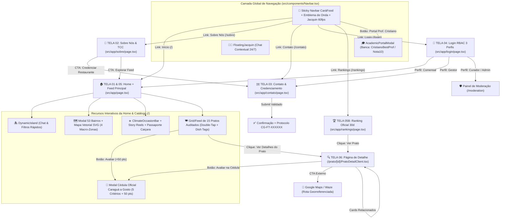

# 🌊 DOSSIÊ TÉCNICO, ESTRUTURAL E FUNCIONAL COMPLETO — CARÁFOOD (CARAGUÁ FOODTECH)

> **Propósito do Documento:** Exportação exaustiva de 100% da realidade técnica, arquitetural, funcional e de dados do repositório **CaráFood (`caragua-foodtech-mono`)** para fundamentação do **Relatório Parcial Consolidado (Semanas S01 a S10 — Base A2)** e **Entrega Final (A1 / TCC)** da disciplina de **Análise e Projeto de Sistemas II (APS II)** do **Centro Universitário Módulo**, sob avaliação do **Prof. Me. Cristiano S. Negrão**.

---

## 1. Identificação, Equipe e Links Oficiais

### 1.1 Identificação Institucional e Links de Produção
| Atributo | Especificação Real no Repositório |
| :--- | :--- |
| **Nome Oficial do Sistema** | **CaráFood** *(anteriormente Caraguá FoodTech)* — Plataforma Hiperlocal de Descoberta Gastronômica, Rastreabilidade Caiçara e Auditoria Algorítmica dos 53 Bairros de Caraguatatuba/SP |
| **Instituição de Ensino** | Centro Universitário Módulo — Cruzeiro do Sul Educacional (Campus Caraguatatuba/SP) |
| **Curso Superior** | Tecnologia em Análise e Desenvolvimento de Sistemas (ADS) |
| **Disciplina** | Análise e Projeto de Sistemas II (APS II) / Trabalho de Conclusão de Curso (TCC) — Semestre 2026.1 |
| **Docente Orientador e Avaliador** | **Prof. Me. Cristiano S. Negrão** |
| **URL Pública Principal (Produção Vercel)** | `https://foddtech.vercel.app/` |
| **Rotas Públicas Ativas em Produção** | • `https://foddtech.vercel.app/` (Home, Feed & Explorador dos 53 Bairros)<br>• `https://foddtech.vercel.app/sobre` (Sobre Nós & Alinhamento TCC)<br>• `https://foddtech.vercel.app/contato` (Contato, Credenciamento B2B & Geração de Protocolo)<br>• `https://foddtech.vercel.app/login` (Tela de Login RBAC com 3 Perfis)<br>• `https://foddtech.vercel.app/rankings` (Ranking Oficial & Decaimento Temporal de 30 dias)<br>• `https://foddtech.vercel.app/prato/post-1` (Página Master-Detail de Prato Dinâmica)<br>• `https://foddtech.vercel.app/moderation` (Painel de Moderação de Ofertas/Cardápios)<br>• `https://foddtech.vercel.app/rag-test` (Playground Interativo do Pipeline RAG de 5 Estágios) |
| **Repositório Oficial no GitHub** | `https://github.com/GaboBiroo/caragua-foodtech-mono.git` *(também referenciado nos relatórios como `https://github.com/Gabriell1908/caragua-foodtech-mono`)* |
| **Branch Principal** | `main` (`remotes/origin/main`) |

### 1.2 Composição Oficial do Grupo Discente
| Nome Completo | RGM (Status no Repositório) | E-mail Cadastrado | Papel Principal e Responsabilidades Técnicas |
| :--- | :--- | :--- | :--- |
| **Gabriel Rodrigues** | `[Sinalizado para preenchimento: Informar RGM no .docx]` | `Gabrielhrodrigues8@gmail.com` / `gabriel.rodrigues@modulo.edu.br` | **Product Owner, Tech Lead & Desenvolvedor Full-Stack:** Arquitetura Next.js 14, Pipeline RAG de 5 Estágios, Prompt Engineering do Chef Jacquin Praiano, integração Vercel e Design System. |
| **Matheus Vicente** | `[Sinalizado para preenchimento: Informar RGM no .docx]` | `matheus.vicente@modulo.edu.br` | **Engenharia de Requisitos, Back-End & Banco de Dados:** Modelagem relacional/geoespacial (PostgreSQL + PostGIS + `pgvector`), malha H3 dos 53 bairros, schemas Pydantic V2 e SQLAlchemy 2.0. |
| **Pedro Simone** | `[Sinalizado para preenchimento: Informar RGM no .docx]` | `pedro.simone@modulo.edu.br` | **Engenharia de Front-End, UX/UI & Garantia de Qualidade (QA):** Interfaces reativas, acessibilidade WCAG 2.2 AAA, bateria de testes de usabilidade (S12) e documentação acadêmica (S01–S16). |

### 1.3 Stack Tecnológica Completa (Versões Exatas do Repositório)

#### A. Front-End Web Principal (`/package.json` e `/web-admin/package.json`)
- **Framework Principal:** `next` `^14.2.24` (Next.js 14 App Router com Server & Client Components e Serverless API Routes)
- **Biblioteca UI Core:** `react` `^18.2.0` e `react-dom` `^18.2.0`
- **Linguagem e Tipagem Estática:** `typescript` `^5.4.5` (`@types/node` `^20.12.7`, `@types/react` `^18.3.1`, `@types/react-dom` `^18.3.0`)
- **Estilização e Design Tokens:** `tailwindcss` `^3.4.3`, `postcss` `^8.4.38`, `autoprefixer` `^10.4.19`, `clsx` `^2.1.1`, `tailwind-merge` `^2.3.0`
- **Motor de Animações Físicas (60fps):** `framer-motion` `^14.0.0`
- **Biblioteca de Ícones Vetoriais:** `lucide-react` `^0.378.0`

#### B. Back-End Python, IA, Geoprocessamento & Antifraude (`/backend/requirements.txt`)
- **Servidor API Assíncrono:** `fastapi` `>=0.110.0,<0.111.0`, `uvicorn[standard]` `>=0.28.0,<0.29.0`, `python-multipart` `>=0.0.9,<0.1.0`
- **Validação de Dados e Configurações:** `pydantic` `>=2.6.4,<3.0.0`, `pydantic-settings` `>=2.2.1,<3.0.0`
- **ORM, Banco Relacional, Vetorial e Geoespacial:** `sqlalchemy` `>=2.0.28,<2.1.0`, `asyncpg` `>=0.29.0,<0.30.0`, `pgvector` `>=0.2.5,<0.3.0`, `geoalchemy2` `>=0.14.6,<0.15.0`, `shapely` `>=2.0.3,<3.0.0`, `alembic` `>=1.13.1,<2.0.0`
- **Indexação Geoespacial Hexagonal:** `h3` `>=3.7.7,<4.0.0` (Uber H3 Spatial Index), `geohash2` `>=1.1,<2.0`
- **Orquestração de LLMs e RAG:** `langchain` `>=0.1.13,<0.2.0`, `langchain-community` `>=0.0.29,<0.1.0`, `langchain-core` `>=0.1.33,<0.2.0`, `langchain-openai` `>=0.1.0,<0.2.0`, `langchain-anthropic` `>=0.1.4,<0.2.0`, `sentence-transformers` `>=2.5.1,<3.0.0`, `tiktoken` `>=0.6.0,<0.7.0`
- **Coleta Automatizada (Web Scraping):** `playwright` `>=1.42.0,<1.43.0`, `httpx` `>=0.27.0,<0.28.0`
- **Ciência de Dados e Detecção de Fraude (SMOTE + Random Forest / Z-Score):** `scikit-learn` `>=1.5.0`, `imbalanced-learn` `>=0.12.0`, `numpy` `>=2.0.0`, `pandas` `>=2.2.0`
- **Segurança, Criptografia e Cache:** `python-jose[cryptography]` `>=3.3.0,<4.0.0`, `passlib[bcrypt]` `>=1.7.4,<2.0.0`, `redis` `>=5.0.3,<6.0.0`

#### C. Aplicativo Mobile Híbrido (`/mobile/package.json`)
- **Ecossistema Mobile:** `expo` `~52.0.0`, `react-native` `0.76.5`, `expo-router` `~4.0.0`, `nativewind` `^4.1.0`
- **Estado, Cache e UI Mobile:** `zustand` `^4.5.2`, `@tanstack/react-query` `^5.32.0`, `@gorhom/bottom-sheet` `^4.6.4`, `react-native-reanimated` `~3.16.0`, `expo-location` `~18.0.0`, `expo-blur` `~14.0.0`, `expo-haptics` `~14.0.0`

#### D. Infraestrutura de Banco de Dados e Hospedagem (`/docker-compose.yml` e `/vercel.json`)
- **Banco de Dados Híbrido Containerizado:** PostgreSQL 16 + extensão espacial **PostGIS 3.4** + extensão vetorial **pgvector** (`docker/Dockerfile.db` e `docker/init-db.sql`) + **Redis 7 Alpine**
- **Cloud Hosting & CI/CD:** Vercel Cloud Platform (Edge Network global, HTTPS/TLS 1.3 nativo, build automatizado a cada `git push origin main`)

---

## 2. Árvore Completa de Diretórios e Rotas (Mapa de Arquivos)

### 2.1 Árvore Completa do Repositório (265 Arquivos de Projeto)
```text
caragua-foodtech-mono/
├── .gitignore
├── AI_CONTEXT.md
├── DOSSIE_COMPLETO_CARAFOOD.md
├── GEMINI.md
├── README.md
├── docker-compose.yml
├── next-env.d.ts
├── next.config.js
├── package-lock.json
├── package.json
├── postcss.config.js
├── tailwind.config.js
├── tsconfig.json
├── vercel.json
│
├── src/                                      # Aplicação Web Principal (Next.js 14 App Router)
│   ├── app/
│   │   ├── globals.css                       # Tokens CSS WCAG 2.2 AAA, keyframes Coucou e utilitários
│   │   ├── layout.tsx                        # Root Layout, metadados SEO/OpenGraph e fontes
│   │   ├── page.tsx                          # [ROTA /] Home, Hero, Dynamic Island, 53 Bairros e Feed
│   │   ├── sobre/
│   │   │   └── page.tsx                      # [ROTA /sobre] Página Sobre Nós, Manifesto Caiçara e Equipe
│   │   ├── contato/
│   │   │   └── page.tsx                      # [ROTA /contato] Formulário Validado, Protocolo CG-FT e FAQ
│   │   ├── login/
│   │   │   └── page.tsx                      # [ROTA /login] Autenticação RBAC (3 Perfis) e Simulador S07
│   │   ├── rankings/
│   │   │   └── page.tsx                      # [ROTA /rankings] Pódio Oficial e Decaimento Temporal 30d
│   │   ├── prato/
│   │   │   └── [id]/
│   │   │       ├── page.tsx                  # [ROTA /prato/[id]] Server Wrapper com generateStaticParams
│   │   │       └── PratoDetailClient.tsx     # [ROTA /prato/[id]] View Master-Detail + Cédula 5 Critérios
│   │   ├── moderation/
│   │   │   └── page.tsx                      # [ROTA /moderation] Painel Admin de Aprovação de Ofertas
│   │   ├── rag-test/
│   │   │   └── page.tsx                      # [ROTA /rag-test] Playground SSE do Pipeline RAG 5 Estágios
│   │   └── api/
│   │       ├── chat/route.ts                 # [API POST /api/chat] Concierge IA Regionalizado
│   │       ├── restaurants/route.ts          # [API GET /api/restaurants] Listagem JSON de Restaurantes
│   │       ├── reviews/route.ts              # [API POST /api/reviews] Submissão com Sanitização LGPD
│   │       └── search/route.ts               # [API GET /api/search] Busca por Query e Polo Territorial
│   ├── components/
│   │   ├── Navbar.tsx                        # Barra Global Sticky + Emblema de Onda + Jacquin 60fps
│   │   ├── DynamicIsland.tsx                 # Ilha Dinâmica Expansível do Chef Jacquin no Header
│   │   ├── FloatingJacquin.tsx               # Assistente Flutuante no Canto Inferior Direito + Chat
│   │   ├── AcademicPortalModal.tsx           # Portal da Banca Examinadora (Prof. Cristiano Negrão)
│   │   ├── CorporateUXSuite.tsx              # Suite Industrial: Mapa Vetorial SVG, Passaporte, Reels, Sparkline
│   │   ├── JacquinChatDrawer.tsx             # Gaveta Lateral de Conversação com o Chef
│   │   ├── JacquinPraianoAvatar.tsx          # Componente Vetorial/Imagem do Avatar Praiano
│   │   ├── Header.tsx                        # Cabeçalho Administrativo (Moderação / RAG Playground)
│   │   ├── MetricCard.tsx                    # Cartão de Indicadores de Telemetria
│   │   ├── Sidebar.tsx                       # Barra Lateral do Backoffice Administrativo
│   │   ├── admin/
│   │   │   ├── AdminView.tsx                 # Visão de Auditoria Algorítmica e Food Safety
│   │   │   └── RAGArchitectureView.tsx       # Visualizador Técnico dos 5 Estágios do RAG
│   │   └── consumer/
│   │       ├── CreditsTab.tsx                # Sistema de Créditos Gourmet (CR) + Simulador B2B
│   │       ├── FeedTab.tsx                   # Aba de Feed Social Gastronômico
│   │       ├── RadarTab.tsx                  # Radar de Alertas em Tempo Real (Spikes, Scrapers, Bots)
│   │       ├── ReviewTab.tsx                 # Emissor de Avaliações Ponderadas
│   │       └── SearchTab.tsx                 # Busca Hiperlocal com Filtros Dietéticos
│   └── data/
│       └── caraguaData.ts                    # Fonte da Verdade: 53 Bairros, 6 Restaurantes, 12 Pratos, 12 Posts, 4 Alertas
│
├── web-admin/                                # Espelho Sincronizado para Build/Deploy Vercel NFT Trace
│   ├── next.config.js
│   ├── package.json
│   ├── tailwind.config.js
│   ├── public/ (icon.svg, jacquin-praiano.png, manifest.json)
│   └── src/ (espelho integral de src/app, src/components e src/data)
│
├── backend/                                  # Back-End Python (FastAPI + PostGIS + pgvector + Scikit-Learn)
│   ├── .env.example
│   ├── requirements.txt
│   ├── app/
│   │   ├── main.py                           # Aplicação FastAPI + CORS + Registro de Rotas
│   │   ├── api/
│   │   │   ├── dependencies.py               # Injeção de Sessão Assíncrona do Banco
│   │   │   └── routes/
│   │   │       ├── health.py                 # Healthcheck de Containers
│   │   │       ├── moderation.py             # Endpoints de Homologação de Promoções
│   │   │       ├── restaurants.py            # Endpoints Geoespaciais e Decaimento Temporal
│   │   │       └── search.py                 # Endpoint Streaming SSE do RAG de 5 Estágios
│   │   ├── core/
│   │   │   ├── config.py                     # Configurações de Ambiente Pydantic
│   │   │   └── llm_manager.py                # Roteador Multi-LLM (OpenAI / Anthropic / Local)
│   │   ├── db/
│   │   │   ├── caragua_catalog.py            # Catálogo Base de Sementes do Município
│   │   │   ├── session.py                    # Engine SQLAlchemy AsyncPG
│   │   │   └── models/
│   │   │       ├── base.py                   # Declarative Base SQLAlchemy 2.0
│   │   │       ├── restaurant.py             # Modelo Restaurant (Geometry Point PostGIS + H3 Index)
│   │   │       ├── dish.py                   # Modelo Dish (Flags Vegano, Sem Glúten, Preço)
│   │   │       ├── review.py                 # Modelo Review (Hash Autor LGPD, Z-Score, Meia-Vida)
│   │   │       └── embedding.py              # Modelo VectorEmbedding (pgvector 1536 dimensões)
│   │   ├── schemas/
│   │   │   ├── intent.py                     # Schema Pydantic de Extração de Intenção e Alérgenos
│   │   │   └── restaurant.py                 # DTOs de Resposta da API
│   │   ├── services/
│   │   │   └── rag_pipeline.py               # Implementação dos 5 Estágios do Pipeline RAG
│   │   └── workers/
│   │       ├── fraud_detector.py             # Detector de Anomalias (SMOTE + Random Forest + Z-Score)
│   │       ├── nightly_batch.py              # Job Noturno (03:00 AM) de Recálculo de Notas
│   │       ├── sanitizer_lgpd.py             # Anonimizador de PII (CPF, Telefone, E-mail, Hash SHA-256)
│   │       ├── scraper_engine.py             # Orquestrador de Coleta Externa
│   │       └── scraper_playwright.py         # Interceptador XHR Headless para Cardápios Públicos
│   └── scripts/
│       ├── generate_qrcodes.py
│       ├── init_db.py
│       ├── seed_caragua_data.py
│       ├── test_rag_pipeline.py
│       └── test_scraping_and_fraud.py
│
├── mobile/                                   # App Mobile Nativo (React Native + Expo 52 + NativeWind)
│   ├── app.json
│   ├── package.json
│   └── src/
│       ├── app/ ((tabs)/index.tsx, map.tsx, profile.tsx, search.tsx, chat/index.tsx, restaurant/[id].tsx)
│       ├── components/ (ai/*, feed/*, ui/*)
│       ├── hooks/ (useAIStream.ts, useDecayMathematics.ts, useLocation.ts)
│       ├── services/ (api.ts, sse.ts)
│       └── store/ (useAppStore.ts)
│
├── docs/                                     # Documentação Acadêmica, Arquitetural e Dossiês de Pesquisa
│   ├── ESCOPO_APSII_PROF_NEGRAO.md           # Bíblia de Requisitos da Disciplina (S01 a S18)
│   ├── academic/
│   │   ├── APSII_S02_CARAGUA_FOODTECH.docx
│   │   ├── APSII_S10_CARAFOOD.docx
│   │   ├── dossie_academico_tcc_a2_prof_cristiano.md
│   │   └── relatorio_tecnico_etapa_1_entrega_parcial.md
│   ├── architecture/
│   │   ├── AI_CONTEXT.md
│   │   ├── GEMINI.md
│   │   └── arquitetura_frontend_rag_caragua_dossie.md
│   ├── audits/
│   │   └── diagnostico_critico_reddit_it_e_15_melhorias.md
│   └── research/
│       ├── dossie_caraguatatuba_e_prompt_engineering_jacquin.md
│       ├── dossie_design_industrial_e_benchmark_top200.md
│       ├── dossie_enciclopedico_caraguatatuba_oficial.md
│       ├── plano_mestre_scraping_e_llm_jacquin.md
│       ├── prompt_mestre_deep_research_caraguatatuba.md
│       ├── prompt_mestre_deep_research_design_industrial.md
│       └── trilha_design_industrial_ux_3_meses_carafood.md
│
├── entregas_aps2/                            # Pasta Estruturada por Semana Letiva (S01 a S16 — 58 arquivos)
│   ├── README.md
│   ├── S01_Registro_Inicial/                 # (01_O_QUE_FOI_PEDIDO.md, 02_RELATORIO_PREENCHIDO.md, 03_TEXTO_ENVIO_PORTAL.txt)
│   ├── S02_Prototipo_Historias_Mapa/         # (+ PROTOTIPO_PARA_PRINT.html)
│   ├── S03_Home_Landing_Page/
│   ├── S04_Pagina_Sobre_Nos/
│   ├── S05_Pagina_Contato/
│   ├── S06_Menu_Navegacao/
│   ├── S07_Tela_Login/
│   ├── S08_Lista_Catalogo/
│   ├── S09_Pagina_Detalhe/
│   ├── S10_A2_Entrega_Intermediaria/         # (+ APSII_S10_CARAFOOD.docx, PROTOTIPO_PARA_PRINT.html, prototipo_historico_v02_git.html)
│   ├── S11_Melhoria_Versionamento/
│   ├── S12_Testes_Usabilidade/
│   ├── S13_Deploy_Banco/
│   ├── S14_DNS_URL_Amigavel/
│   ├── S15_Checklist_Apresentacao/           # (+ 04_CHECKLIST_FINAL_PREENCHIDO.md)
│   └── S16_A1_Entrega_Final/
│
├── docker/ (Dockerfile.db, init-db.sql)
├── legacy/prototypes/ (caragua-liquid-glass.html, index.html, mobile-preview.html)
├── public/ (icon.svg, jacquin-praiano.png, manifest.json)
└── scripts/ (copy-build.js, tools/generate_docx.py, generate_standalone_html.py, run.py, run_all.py)
```

### 2.2 Mapeamento Completo de Rotas Web e API
| Rota / Endpoint | Tipo | Arquivo Renderizador / Handler | Descrição Funcional |
| :--- | :--- | :--- | :--- |
| `/` | Página Web (UI) | `src/app/page.tsx` | **Home / Landing Page + Lista Principal (Catálogo/Feed):** Hero com emblema de onda, botão do Passaporte Gourmet (`350 Pontos`), `DynamicIsland` do Chef Jacquin, barra dos 10 Polos em destaque + modal dos 53 Bairros (com Mapa Vetorial SVG interativo), barra `ClimateOccasionBar`, busca textual com sugestões caiçaras, 10 pílulas de categoria, Feed de 12 cards orgânicos com double-tap de partículas douradas, In-Image Dish Tagging e modal de emissão da Cédula Oficial de 5 critérios. |
| `/sobre` | Página Web (UI) | `src/app/sobre/page.tsx` | **Página Sobre Nós (S04):** Contexto socioeconômico de Caraguatatuba (134 mil hab., 53 bairros, AMAPEC Cocanha e Colônia Z-8), dores estruturais do mercado, cartões de Missão/Visão/Valores, conexão explícita com as Seções 1.1 e 1.2 do relatório de APS II, Reflexão Pedagógica de UX assinada e Ficha Técnica da equipe discente. |
| `/contato` | Página Web (UI) | `src/app/contato/page.tsx` | **Página de Contato e Credenciamento (S05):** Formulário validado com 6 campos, geração de número de protocolo dinâmico (`CG-FT-XXXXXX`), canais oficiais no Centro Universitário Módulo e FAQ de credenciamento gratuito. |
| `/login` | Página Web (UI) | `src/app/login/page.tsx` | **Tela de Login RBAC (S07):** Autenticação com 3 perfis pré-configurados em 1 clique (`Comensal Auditado`, `Gestor de Restaurante`, `Curador / Admin Módulo`), alternância de visibilidade de senha, botão `"Simular Erro (S07)"` (HTTP 401) e tela de sessão autenticada com redirecionamento contextual. |
| `/rankings` | Página Web (UI) | `src/app/rankings/page.tsx` | **Lista Comparativa / Ranking Oficial (S08):** Explicação metodológica do Decaimento Exponencial (meia-vida de 30 dias), Filtro Anti-Fraude Z-Score e Cédula Caraguá a Gosto, seguida da tabela comparativa do Pódio Gastronômico com links diretos para `/prato/[id]`. |
| `/prato/[id]` | Página Dinâmica (SSR/SSG + Client) | `src/app/prato/[id]/page.tsx` + `src/app/prato/[id]/PratoDetailClient.tsx` | **Página de Detalhe do Item (S09):** Breadcrumb hierárquico (`Início > Bairro > Prato`), foto HD com badges Liquid Glass (Selo AMAPEC, Patrimônio Imaterial, Colônia Z-8), preço, Super Nota Ponderada com curva `DecaySparklineBadge` e índice espacial `H3 Res.9`, parecer do Chef Jacquin, botão Google Maps/Waze, modal da Cédula Oficial (+50 pontos), Ficha Técnica de Rastreabilidade, lista viva de avaliações e 3 pratos recomendados relacionados. |
| `/moderation` | Página Web (Admin) | `src/app/moderation/page.tsx` | **Painel de Moderação Noturna:** Interface para aprovar (`✓ Aprovar Prato`) ou rejeitar (`✕ Rejeitar`) pratos e promoções capturados via Playwright XHR antes da indexação pública. |
| `/rag-test` | Página Web (Tech) | `src/app/rag-test/page.tsx` | **Playground do Pipeline RAG de 5 Estágios:** Permite testar consultas em linguagem natural com checkboxes de restrição celíaca (`isCeliac`) e vegana (`isVegan`), exibindo a síntese gerativa via streaming SSE. |
| `POST /api/chat` | Serverless API | `src/app/api/chat/route.ts` | Recebe `{ query }` e retorna resposta contextualizada do Chef com cartão de recomendação (`restaurantCard`) para os polos Centro, Indaiá, Massaguaçu, Porto Novo e Martim de Sá. |
| `GET /api/restaurants` | Serverless API | `src/app/api/restaurants/route.ts` | Retorna JSON com todos os estabelecimentos auditados (`INITIAL_RESTAURANTS`) e contagem de polos. |
| `POST /api/reviews` | Serverless API | `src/app/api/reviews/route.ts` | Recebe nova avaliação e executa sanitização automática de conformidade LGPD via Regex (`[CPF_REMOVIDO]` e `[TEL_REMOVIDO]`). |
| `GET /api/search` | Serverless API | `src/app/api/search/route.ts` | Filtra estabelecimentos e pratos por query string `?q=` e `?polo=`. |

---

## 3. Auditoria das 6 Páginas Obrigatórias da Disciplina (Padrão S01–S09)

### 3.1 Página 1: Home / Landing Page (`/`) — `src/app/page.tsx`
- **O que aparece na tela:**
  1. **Navbar Global Fixa (`Navbar.tsx`):** Logo **CaráFood** com `CaraguaWaveEmblem` (SVG animado de ondas e sol inspirado no brasão da Prefeitura de Caraguatatuba), avatar recortado do **Chef Jacquin Praiano** com física elástica 60fps que acompanha o cursor do mouse, links para as 5 rotas principais (`Início`, `Sobre Nós`, `Contato`, `Rankings`, `Login`) e botão dourado `Portal Prof. Cristiano`.
  2. **Header Hero Monumental:** Tagline `"CaráFood • O App Oficial da Gastronomia de Caraguatatuba"`, título principal `"Sabores Caiçaras & Roteiro dos 53 Bairros"`, subtítulo explicando a cobertura da Fazenda da Cocanha (AMAPEC) ao Azul-Marinho na panela de ferro, e botão interativo **`★ 350 Pontos Gourmet [Passaporte]`** que abre o modal gamificado `PassaporteCarafoodModal`.
  3. **Dynamic Island do Chef Jacquin (`DynamicIsland.tsx`):** Barra interativa no interior do header que, ao ser clicada, se expande em um console de chat ao vivo com o Chef Jacquin, contendo 6 chips de pergunta rápida (`🦪 Mexilhão da Cocanha`, `🏺 Azul-Marinho`, `🐙 Polvo no Aloha`, `🐟 Peixe fresco da orla`, `🏆 Vencedores Caraguá a Gosto`, `🍕 Pizza artesanal a lenha`) que já filtram automaticamente o catálogo ao responder.
  4. **Barra Sticky de Polos Gastronômicos + Despoluidor dos 53 Bairros:** Exibe os **10 Polos Curados** em destaque (`Destaques (53)`, `Centro`, `Martim de Sá`, `Indaiá`, `Cocanha`, `Prainha`, `Tabatinga`, `Tinga`, `Massaguaçu`, `Porto Novo`) + botão **`Explorar todos os 53 Bairros`** (e círculo `+43 Ver 53 Bairros`), que abre o modal completo com **Mapa Vetorial Interativo SVG (`CaraguaInteractiveVectorMap`)** e divisão nas **4 Macro-Zonas Territoriais**.
  5. **Barra Sensorial de Clima & Ocasião (`ClimateOccasionBar`):** Permite filtrar o feed por contexto climático/sensorial (`Todos os Climas`, `☀️ Sol & Pé na Areia`, `🌧️ Noite, Chuva & Panela de Ferro`, `🦪 Rota AMAPEC & Z-8`), além de botões para abrir os **Stories/Reels Verticais (`DishStoryReelModal`)**, o **Passaporte Caiçara** e a **Trilha de Design System de 3 Meses (`DesignSystemRoadmapModal`)**.
- **Chamadas para Ação (CTAs) e Atalhos:**
  - `Explorar todos os 53 Bairros` (abre o modal geográfico completo);
  - `Ver Detalhes e Avaliações do Prato` (leva para `/prato/[id]`);
  - `Avaliar na Cédula Oficial (+50 pts)` (abre o modal da cédula de 5 critérios);
  - Rodapé institucional com links diretos para `/sobre`, `/contato`, `/rankings` e abertura do `AcademicPortalModal`.

### 3.2 Página 2: Sobre Nós (`/sobre`) — `src/app/sobre/page.tsx`
- **Conteúdo e Propósito:**
  - **Hero Institucional:** Badge `"Entrega S04 • Análise e Projeto de Sistemas II"`, título `"Nossa Missão: Conectar o Comensal à Alma Caiçara de Caraguatatuba"` e apresentação do projeto como TCC de ADS no Centro Universitário Módulo.
  - **Contexto Regional & Hiperlocal ("O Negócio Real: A Força da Costa Norte Paulista"):** Retrata os mais de 134 mil habitantes de Caraguatatuba, os **53 bairros oficiais**, a maricultura *longline* na **Fazenda Marinha da Cocanha (AMAPEC)**, o desembarque pesqueiro na **Colônia de Pescadores Z-8 do Camaroeiro** e o patrimônio imaterial do **Azul-Marinho** na panela de ferro.
  - **Diagnóstico de Dores do Mercado:** Dois blocos analíticos detalhando: (1) *Dependência e Sazonalidade Extrema* (taxas de 27% a 30% de apps tradicionais e concentração de 85% da visibilidade apenas na orla turística, negligenciando bairros como Tinga, Pegorelli, Barranco Alto e Perequê-Mirim); e (2) *Opacidade e Avaliações Falsas* (*fake reviews* sem auditoria técnica).
  - **Tríade Estratégica (Missão, Visão e Valores):** Cards dedicados com foco em democratização dos 53 bairros, integração com o festival *Caraguá a Gosto*, transparência estatística anti-fraude e acessibilidade WCAG 2.2 AAA.
  - **Conexão Direta com o Relatório da Disciplina:** Quadro explicando o vínculo exato com a **Seção 1.1 (Contexto & Problema)** e **Seção 1.2 (Justificativa & Objetivos)**.
  - **Reflexão Pedagógica de UX:** Depoimento autoral de 7 linhas assinado por Gabriel Rodrigues sobre a tradução de fórmulas de decaimento temporal e antifraude em interfaces de baixa carga cognitiva.
  - **Ficha Técnica do Grupo:** Cartões dos 3 integrantes (**Gabriel Rodrigues**, **Matheus Vicente** e **Pedro Simone**) e do orientador **Prof. Cristiano S. Negrão**, encerrando com 2 CTAs (`Explorar Feed Gastronômico de Caraguá` ➔ `/` e `Credenciar Restaurante / Falar Conosco` ➔ `/contato`).

### 3.3 Página 3: Contato / Credenciamento (`/contato`) — `src/app/contato/page.tsx`
- **Campos Exatos do Formulário e Tipos de Input:**
  1. **Tipo de Solicitação (`<select>`):** Valor padrão `'credenciamento'`. Opções exatas:
     - `credenciamento`: `"🏪 Credenciar Restaurante ou Quiosque (0% Taxa)"`
     - `prato`: `"🍲 Sugerir Prato Típico ou Patrimônio Caiçara"`
     - `amapec`: `"🦪 Parceria Produtor Local (AMAPEC / Colônia Z-8)"`
     - `academico`: `"🎓 Dúvida Acadêmica TCC / Prof. Cristiano Negrão"`
     - `suporte`: `"🛠️ Suporte Técnico / Reportar Inconsistência"`
  2. **Nome Completo (`<input type="text" required>`):** Placeholder `"Ex: João Caiçara"`.
  3. **E-mail (`<input type="email" required>`):** Placeholder `"joao@restaurante.com.br"`.
  4. **WhatsApp / Telefone (`<input type="tel" required>`):** Placeholder `"(12) 99876-5432"`.
  5. **Bairro de Caraguatatuba (`<input type="text">`):** Valor inicial `'Martin de Sá'`, placeholder `"Ex: Martim de Sá, Cocanha, Tinga, Indaiá, Massaguaçu..."`.
  6. **Mensagem ou Descrição do Negócio (`<textarea required rows={4}>`):** Placeholder `"Conte um pouco sobre seu prato típico, especialidade ou proposta de parceria..."`.
- **Validações, Protocolo e Persistência de Estado:**
  - Validação nativa HTML5 (`required`, formato `email` e `tel`) + estado de carregamento `isSubmitting` (`"Registrando solicitação..."` por 900ms).
  - Ao submeter, gera um número de protocolo único no formato **`CG-FT-XXXXXX`** (`const protocolNumber = 'CG-FT-' + Math.floor(100000 + Math.random() * 900000)`) armazenado no state React `submittedProtocol`, renderizando a tela de confirmação com os dados do solicitante e botão `"Enviar Outra Mensagem"`.
  - Na coluna lateral direita, exibe os **Canais Oficiais do Projeto** (Sede no Centro Universitário Módulo, CEP `11660-000`, e-mail `Gabrielhrodrigues8@gmail.com`, atendimento Seg–Sex 09h às 18h) e **FAQ de Credenciamento** (3 perguntas e respostas sobre gratuidade 0% taxa, selo *Caraguá a Gosto* e inclusão de restaurantes fora da orla).

### 3.4 Página 4: Login / Área Restrita (`/login` + `AcademicPortalModal.tsx`)
O sistema conta com **dois mecanismos de autenticação complementares**:

#### A. Rota Dedicada `/login` (`src/app/login/page.tsx` — Entrega S07)
- **3 Perfis RBAC Configurados com Preenchimento Automático em 1 Clique (`DEMO_PROFILES`):**
  | ID Perfil (`UserRole`) | Título do Perfil | E-mail de Demonstração | Senha Padrão | Redirecionamento Pós-Login (`redirectHref`) | Privilégios de Negócio Atribuídos |
  | :--- | :--- | :--- | :--- | :--- | :--- |
  | `comensal` | **Comensal Auditado** *(Morador ou Turista • Caraguá a Gosto)* | `comensal@carafood.com.br` | `Carafood@2026` | `/` (*"Ir para o Feed & Emitir Cédula (+50 pts)"*) | • Emissão de Cédulas Oficiais de 5 Critérios Ponderados<br>• Acúmulo de Pontos Gourmet e Carimbos nas 4 Macro-Regiões<br>• Sincronização da coleção pessoal `"📌 Meus Salvos"` |
  | `gestor` | **Gestor de Restaurante** *(Parceiro Credenciado • 53 Bairros)* | `gestor@restaurante.com.br` | `Carafood@2026` | `/contato` (*"Acessar Portal de Credenciamento & Cardápio"*) | • Atualização de preços reais, fotos e In-Image Dish Tags<br>• Visualização da curva de meia-vida de 30 dias ($\lambda = \ln(2)/30$)<br>• Solicitação de selo oficial AMAPEC Cocanha ou Colônia Z-8 |
  | `curador` | **Curador / Admin Módulo** *(Prof. Cristiano S. Negrão & Banca SECTUR)* | `cristiano@modulo.edu.br` | `Carafood@2026` | `/moderation` (*"Abrir Painel de Moderação Anti-Fraude"*) | • Auditoria estatística de avaliações retidas pelo filtro Z-Score ($\|Z\| > 2.5$)<br>• Homologação de novos restaurantes nos 53 bairros<br>• Inspeção completa dos artefatos de APS II (S01 a S16) |
- **Validações e Simulação de Erro S07:**
  - Valida presença de `@` no e-mail e comprimento mínimo de 6 caracteres na senha (`password.trim().length < 6`).
  - Possui botão dedicado **`"Simular Erro (S07)"`** que preenche senha `'123'` e dispara o alerta visual vermelho: *"Falha de Autenticação (HTTP 401): Senha incorreta ou inferior a 6 caracteres. Verifique suas credenciais ou utilize um perfil de demonstração abaixo."*
  - Possui botão de alternância de visibilidade de senha (`Eye` / `EyeOff`) e estado `authState === 'success'` com confirmação de emissão de token JWT e botões de redirecionamento.

#### B. Modal da Banca Examinadora (`src/components/AcademicPortalModal.tsx`)
- Acessível a partir de qualquer página clicando no botão **`Portal Prof. Cristiano`** na `Navbar`.
- **Credencial Exclusiva da Banca:** Usuário `CristianoBestProf` | Senha `Nota10` (também possui botão Quick-Auth `"Entrar como Banca Avaliadora"`).
- Desbloqueia 4 abas técnicas internas: `Pipeline RAG 5 Estágios`, `Fórmula & Decaimento Temporal`, `Scrapers & Anti-Fraude` e `Agradecimento & TCC`.

### 3.5 Página 5: Lista Principal (`/` e `/rankings`) — `src/app/page.tsx` e `src/app/rankings/page.tsx`
- **Volume Cadastrado:**
  - **53 Bairros Oficiais** de Caraguatatuba (mais a opção agregadora `"Todos os 53 Bairros"` = 54 entradas em `NEIGHBORHOODS`), organizados em **4 Macro-Regiões Territoriais** e **10 Polos Curados de Destaque**.
  - **12 Pratos/Posts Completos no Feed Principal (`INITIAL_FEED_POSTS`)** e **6 Estabelecimentos Completos com Sub-Cardápios e Avaliações (`INITIAL_RESTAURANTS` contendo 12 pratos detalhados)**, totalizando **14 estabelecimentos únicos** representados entre o Feed e o Catálogo Estruturado.
- **Filtros que Funcionam em Tempo Real (`filteredPosts` em `src/app/page.tsx`):**
  1. **Busca Textual com Normalização Diacrítica (`searchQuery`):** Remove acentos via `.normalize('NFD')` e pesquisa simultaneamente em `dishName`, `restaurantName`, `neighborhood`, `caption`, `jacquinTip`, `dishCategory` e `dishTag` (incluindo 6 chips de busca rápida: `Mexilhões da Cocanha`, `Azul-Marinho`, `Polvo Grelhado`, `Iscas no Fubá`, `Forno a Lenha`, `Costela no Tinga`).
  2. **Filtro Territorial pelos 53 Bairros (`selectedNeighborhood`):** Selecionável tanto pela barra horizontal de 10 Polos quanto pelo Modal Completo dos 53 Bairros (que possui busca própria `bairroSearchQuery`, filtro pelas 4 Macro-Regiões e Mapa Vetorial SVG clicável).
  3. **10 Pílulas de Categoria e Restrições (`selectedCategory`):**
     - `todos` (`🍽️ Todos os Posts`)
     - `salvos` (`📌 Meus Salvos (N)`)
     - `premiados` (`🏆 Caraguá a Gosto`)
     - `maricultura` (`🦪 Maricultura Cocanha`)
     - `peixe` (`🐟 Peixes Frescos`)
     - `camarão` (`🦐 Camarões da Costa`)
     - `pizza` (`🍕 Pizzas a Lenha`)
     - `burger` (`🍔 Smash Burgers`)
     - `vegano` (`🌿 Vegano`)
     - `promoção` (`🔥 Promoções`)
  4. **Filtro Sensorial de Clima & Ocasião (`activeOccasion`):** `todos`, `sol-praia` (`☀️ Sol & Pé na Areia`), `noite-panela` (`🌧️ Noite, Chuva & Panela de Ferro`) e `maricultura-z8` (`🦪 Rota AMAPEC & Z-8`).
- **O que cada Card exibe no Feed:**
  - **Cabeçalho do Card:** Avatar do restaurante com anel gradiente, nome do restaurante, selo azul de verificação (`✓`), link clicável do bairro, pílula de distância da praia (`🏖️ Pé na Areia`, `🌊 Orla Marítima` ou `🌴 Eixo Sul / Encosta`) e botão de rota direta no Google Maps.
  - **Mídia Interativa 4:3:** Fotografia em alta definição com zoom suave no hover, suporte a **Double-Tap to Like** com explosão de 14 partículas douradas (`GOLDEN_PARTICLES`), **In-Image Dish Tagging** (pino pulsante nas coordenadas `x%` e `y%` da foto que revela nome técnico, destaque e preço em `R$`), badges superiores em *Liquid Glass* (prêmio *Caraguá a Gosto*, selo *AMAPEC Cocanha*, *Patrimônio Imaterial* ou *Colônia Z-8* e badge de promoção) e pílula inferior da **Super Nota Ponderada** + botão de **Story Reel Vertical**.
  - **Corpo do Card:** Botões de interação social (Curtir com contador dinâmico, Comentar/Emitir Cédula, Compartilhar via Web Share API/Clipboard e Salvar no Roteiro com Toast), nome do prato, etiqueta de preço em `R$`, badge `DecaySparklineBadge` (curva SVG de meia-vida de 30 dias), descrição completa (`caption`), caixa verde-menta com o **Parecer do Chef Jacquin Praiano**, prévia dos comentários auditados e dois CTAs principais: **`Ver Detalhes e Avaliações do Prato`** (link para `/prato/[id]`) e **`Avaliar (+50 pts)`**.

### 3.6 Página 6: Página de Detalhe (`/prato/[id]`) — `src/app/prato/[id]/PratoDetailClient.tsx`
- **Tudo o que aparece ao abrir um prato específico:**
  1. **Breadcrumb Hierárquico:** `Início (/) > Bairro (/?bairro=...) > Nome do Prato`.
  2. **Quadro Visual Esquerdo:** Fotografia em alta resolução com todos os selos territoriais (*Caraguá a Gosto*, *AMAPEC Cocanha*, *Patrimônio Imaterial Azul-Marinho*, *Colônia Z-8 Camaroeiro*, *Promoção*), botões flutuantes de Curtir, Salvar no Roteiro e Compartilhar, e selo inferior `"Origem Auditada: [Google Maps / Comunidade Local / iFood]"`.
  3. **Quadro Técnico Direito:** Avatar e nome do restaurante, bairro e distância em km até o centro, categoria e título do prato, painel de **Valor no Cardápio (`R$`)** lado a lado com a **Super Nota Ponderada (`★ 4.84` a `4.98`)** e total de votos, gráfico `DecaySparklineBadge` de meia-vida de 30 dias, código geoespacial `📍 H3 Res.9 • [Bairro]`, descrição detalhada do preparo e caixa de destaque com o **Parecer Gastronômico do Chef Jacquin**.
  4. **CTAs de Ação Imediata:**
     - `Como Chegar (Abrir no Google Maps / Waze)` — abre busca georreferenciada em nova aba;
     - `Avaliar na Cédula Oficial (+50 Pontos)` — abre o modal interativo da Cédula Oficial do Festival *Caraguá a Gosto*.
  5. **Ficha Técnica do Prato & Insumos Hiperlocais:** 3 cartões detalhando *Polo Gastronômico*, *Rastreabilidade dos Insumos* (`AMAPEC Fazenda Marinha` ou `Colônia Z-8 Camaroeiro`) e *Perfil Nutricional & Dieta* (`🌿 100% Vegano` ou `🦞 Frutos do Mar Frescos`).
  6. **Lista Viva de Avaliações Auditadas + Modal da Cédula Oficial de 5 Critérios:** Exibe todas as avaliações do prato e permite submeter uma nova avaliação calculada em tempo real pelos 5 sliders oficiais:
     - **Critério 1:** Sabor & Tempero Caiçara (**Peso 35%**)
     - **Critério 2:** Apresentação & Cocção (**Peso 20%**)
     - **Critério 3:** Originalidade & Insumos Locais (**Peso 15%**)
     - **Critério 4:** Atendimento & Equipe (**Peso 15%**)
     - **Critério 5:** Ambiente & Higiene (**Peso 15%**)
     - Campo opcional de **Código da Comanda ou Mesa (`tableVoucher`)** (ex.: `MESA-08` ou `CARAGUA-2026`) e comentário textual obrigatório.
  7. **Seção "Mais Pratos Recomendados em Caraguá":** Grid com 3 pratos relacionados priorizando o mesmo bairro ou categoria culinária.

---

## 4. Módulos Extras e Diferenciais Implementados

Além das 6 páginas obrigatórias da disciplina, o repositório possui **8 módulos avançados de engenharia de software e inteligência artificial** já codificados:

1. **Concierge de IA — Chef Jacquin Praiano (`DynamicIsland.tsx` + `FloatingJacquin.tsx` + `api/chat/route.ts` + `backend/app/services/rag_pipeline.py`):**
   - Dupla interface conversacional: **Dynamic Island** embutida no cabeçalho e **Assistente Flutuante** no canto inferior direito com animações de respiração, saudação e pulo a 60fps (`animate-coucou-wave` e `animate-coucou-jump`).
   - No back-end Python (`rag_pipeline.py`), implementa o **Pipeline RAG Determinístico de 5 Estágios**:
     - *Estágio 1:* Extração estruturada de intenção e alérgenos via Pydantic V2 (`schemas/intent.py`);
     - *Estágio 2:* Enriquecimento geoespacial com coordenadas GPS de Caraguatatuba e malha hexagonal Uber H3;
     - *Estágio 3:* Busca híbrida combinando raio métrico cartesiano PostGIS (`ST_DWithin`) e similaridade de cosseno vetorial `pgvector` (`<->`);
     - *Estágio 4:* Injeção factual determinística com *Guardrail de Food Safety* (bloqueio estrito de contaminação cruzada para celíacos e veganos);
     - *Estágio 5:* Síntese narrativa regionalizada entregue via *Server-Sent Events (SSE)*.
2. **Cédula Oficial Auditada do Festival *Caraguá a Gosto* e Decaimento Temporal de 30 Dias (`DecaySparklineBadge` + `rankings/page.tsx`):**
   - Implementa a equação de meia-vida exponencial ($\lambda = \ln(2)/30 \approx 0.0231\text{ dia}^{-1}$) que atribui maior peso às avaliações dos últimos 30 dias, impedindo que estabelecimentos vivam de fama antiga e exibindo micro-gráficos SVG (*sparklines*) em cada card.
3. **Detector Antifraude Estatístico e Sanitizador LGPD (`backend/app/workers/fraud_detector.py` + `sanitizer_lgpd.py` + `api/reviews/route.ts`):**
   - Isolamento de rajadas de *fake reviews* por anomalia estatística ($|Z\text{-Score}| > 2.5$ / $3.2$) e balanceamento SMOTE + Random Forest no worker Python, além de sanitização automática de dados pessoais sensíveis (CPF e telefone) em conformidade com os Arts. 5º e 6º da LGPD.
4. **Suite Corporativa de UX Industrial (`src/components/CorporateUXSuite.tsx`):**
   - **`CaraguaInteractiveVectorMap`:** Mapa vetorial SVG interativo do contorno geográfico de Caraguatatuba (Serra do Mar à esquerda, Oceano Atlântico e Ilhabela à direita, Rio Juqueriquerê ao sul) com pinos clicáveis dos polos gastronômicos;
   - **`PassaporteCarafoodModal`:** Sistema gamificado de selos territoriais nas 4 Macro-Regiões de Caraguatatuba + carteira de **Pontos Gourmet**;
   - **`DishStoryReelModal`:** Visualizador vertical tela cheia estilo Instagram Reels / TikTok para navegação imersiva entre os pratos premiados;
   - **`ClimateOccasionBar`:** Seletor contextual de clima e ocasião gastronômica;
   - **`DesignSystemRoadmapModal`:** Documentação interativa da Trilha de Design Industrial de 3 Meses (Semanas 1 a 12).
5. **Sistema de Créditos Gourmet & Simulador de Impulsionamento Ético B2B (`src/components/consumer/CreditsTab.tsx`):**
   - Carteira de recompensas onde o comensal inicia com `350 CR`, ganha `+50 CR` a cada cédula emitida e pode resgatar benefícios (`Destacar Minha Avaliação no Topo` por `100 CR`, `Selo Morador Local Verificado 1.5x` por `150 CR`, `Resposta Oficial de Proprietário` por `200 CR`), além da aba **Painel B2B / Quiosques (Anunciantes)** para impulsionamento ético de promoções sem alterar a nota algorítmica.
6. **Painel Administrativo de Moderação Noturna (`src/app/moderation/page.tsx` e `src/components/admin/AdminView.tsx`):**
   - Interface de *Human-in-the-Loop* para homologar pratos e promoções coletados pelos scrapers noturnos (`Playwright XHR Ingestion`) e auditar o *Food Safety Score* dos restaurantes.
7. **Portal Secreto da Banca Examinadora (`src/components/AcademicPortalModal.tsx`):**
   - Painel executivo dedicado ao Prof. Me. Cristiano S. Negrão com telemetria do pipeline RAG, fórmula matemática, logs do scraper das 03:00 AM e dedicatória oficial do grupo.
8. **Aplicativo Mobile Multiplataforma (`mobile/`):**
   - Estrutura React Native + Expo Router 52 com abas nativas (`index`, `map`, `search`, `profile`), `JacquinPraianoFAB` e integração SSE.

---

## 5. Catálogo Completo de Dados (Estabelecimentos, Pratos e Bairros)

### 5.1 Os 53 Bairros Oficiais de Caraguatatuba Mapeados (`NEIGHBORHOODS` em `src/data/caraguaData.ts`)
O sistema mapeia integralmente os **53 bairros oficiais** do município de Caraguatatuba, agrupados em **4 Macro-Regiões Territoriais** (`MACRO_REGIONS`):

1. **🌊 Macro-Região 1 — Orla Central, Histórica & Eixo Nobre (15 Bairros):**
   - `centro` (**Centro** — *LLM Centro Histórico • v2.1*: Tradição Caiçara, Gastrobares & Patrimônio)
   - `martim-de-sa` (**Martim de Sá** — *LLM Martim de Sá • v2.4*: Quiosques de Praia, Iscas Frescas & Agito Noturno)
   - `indaia` (**Indaiá** — *LLM Indaiá Gourmet • v2.3*: Alta Gastronomia, Picanha na Brasa & Bistrôs Contemporâneos)
   - `prainha` (**Prainha** — *LLM Prainha Caiçara • v2.0*: Iscas de Peixe-Porco & Culinária Caiçara de Praia)
   - `sumare` (**Sumaré** — *LLM Sumaré Nobre • v2.0*: Cozinha Internacional Contemporânea & Bistrôs)
   - `aruan` (**Aruan** — *LLM Aruan Orla • v2.0*: Quiosques de Orla Estruturados & Sorveterias)
   - `jardim-jaqueira` (**Jardim Jaqueira** — *LLM Jaqueira Express • v1.9*: Pizzarias Delivery, Padarias Artesanais & Marmitarias)
   - `estrela-dalva` (**Estrela D'Alva** — *LLM Estrela D'Alva • v1.8*: Espetarias, Salgaderias & Botecos Tradicionais)
   - `poiares` (**Poiares** — *LLM Poiares Comercial • v1.9*: Churrascarias Comerciais & Rotisserias de Almoço)
   - `pontal-santamarina` (**Pontal Santamarina** — *LLM Pontal & Shopping • v2.0*: Polo Gastronômico Serramar Shopping & Cafés)
   - `jardim-primavera` (**Jardim Primavera** — *LLM Primavera Lanches • v1.8*: Hamburguerias de Bairro & Dogs Prensados)
   - `vila-everest` (**Vila Everest** — *LLM Everest Confeitaria • v1.9*: Cafés Intimistas & Confeitarias Finas de Encosta)
   - `jardim-california` (**Jardim Califórnia** — *LLM Califórnia Pizzas • v1.8*: Pizzarias Noturnas & Marmitas Executivas)
   - `ipiranga` (**Ipiranga** — *LLM Ipiranga Express • v1.8*: Salgados Artesanais Congelados & Marmitarias)
   - `jardim-jaqueira-2` (**Jardim Jaqueira II** — *LLM Jaqueira II Delivery • v1.8*: Hamburguerias de Garagem & Pastéis Especiais)

2. **🦪 Macro-Região 2 — Costa Norte & Maricultura AMAPEC (14 Bairros):**
   - `cocanha` (**Cocanha** — *LLM Cocanha Maricultura • v2.5*: Fazendas Marinhas de Mexilhões AMAPEC & Caldeiradas)
   - `massaguacu` (**Massaguaçu** — *LLM Massaguaçu & Pesca • v2.4*: Peixes Nobres em Travessas Fartas & Pesca Artesanal)
   - `tabatinga` (**Tabatinga** — *LLM Tabatinga Náutica • v2.3*: Beach Clubs Sofisticados, Espeticho & Marinas)
   - `mococa` (**Mococa** — *LLM Mococa Artesanal • v2.1*: Peixes Inteiros na Brasa & Camarão no Bafo)
   - `capricornio` (**Capricórnio** — *LLM Capricórnio Costeira • v1.9*: Quiosques Rústicos Beira-Mar & Lagoa Azul)
   - `getuba` (**Getuba** — *LLM Getuba Estrada • v1.9*: Pastelarias de Estrada & Culinária Caipira)
   - `jetuba` (**Jetuba** — *LLM Jetuba Pesqueiros • v1.8*: Pesqueiros Familiares & Porções de Tilápia Frita)
   - `verde-mar` (**Verde Mar** — *LLM Verde Mar Artesanal • v1.8*: Panificação Artesanal & Quitutes da Mata Atlântica)
   - `praia-brava` (**Praia Brava** — *LLM Praia Brava Selvagem • v1.6*: Ecoturismo, Piqueniques Agrestes & Trilhas)
   - `fazendinha` (**Fazendinha** — *LLM Fazendinha da Mata • v2.0*: Casas de Farinha Caiçara, Taioba & Palmito Pupunha)
   - `jardim-samambaia` (**Jardim Samambaia** — *LLM Samambaia • v1.8*: Rotisserias de Bairro & Lanches na Chapa)
   - `jardim-forest` (**Jardim Forest** — *LLM Forest Confeitaria • v1.8*: Doces Artesanais, Bolos de Festa & Hamburguerias)
   - `casa-branca` (**Casa Branca** — *LLM Casa Branca • v1.9*: Hamburguerias Artesanais & Caldos de Inverno)
   - `olaria` (**Olaria** — *LLM Olaria Tradicional • v1.8*: Petiscos de Boteco & Pequenas Pizzarias)

3. **🏖️ Macro-Região 3 — Orla Sul & Bacia Ribeirinha do Juqueriquerê (14 Bairros):**
   - `porto-novo` (**Porto Novo** — *LLM Porto Novo & Ostras • v2.2*: Ostras Depuradas do Juqueriquerê & Pastéis Caiçaras)
   - `praia-das-palmeiras` (**Praia das Palmeiras** — *LLM Palmeiras Beira-Mar • v1.9*: Peixarias com Fritura na Hora & Comida Caiçara)
   - `jardim-britania` (**Jardim Britânia** — *LLM Britânia Praiano • v1.8*: Lanchonetes de Praia & Pizzarias de Veranistas)
   - `jardim-gaivotas` (**Jardim Gaivotas** — *LLM Gaivotas Delivery • v1.8*: Pizzarias de Forno a Lenha & Hamburguerias)
   - `barranco-alto` (**Barranco Alto** — *LLM Barranco Ribeirinho • v1.8*: Petiscarias Fluviais & Pescados de Água Doce e Salgada)
   - `travessao` (**Travessão** — *LLM Travessão Divisa • v2.0*: Corredor Gastronômico Popular & Espetinhos de Rua)
   - `pereque-mirim` (**Perequê-Mirim** — *LLM Perequê Comunitário • v1.7*: Marmitarias Comunitárias & Porções de Beco)
   - `pegorelli` (**Pegorelli** — *LLM Pegorelli Rural • v1.7*: Quitutes da Roça, Queijos Caseiros & Doces)
   - `tarumas` (**Tarumãs** — *LLM Tarumãs Express • v1.7*: Hamburguerias de Bairro & Lanches Prensados)
   - `golfinho` (**Golfinho** — *LLM Golfinho Residencial • v1.8*: Pizzas Delivery & Açaí Artesanal)
   - `pan-brasil` (**Pan Brasil** — *LLM Pan Brasil • v1.7*: Marmitex Econômico de Balcão & Quitutes)
   - `vila-atlantica` (**Vila Atlântica** — *LLM Vila Atlântica • v1.8*: Bares de Petiscos Tradicionais de Calçada)
   - `balneario-copacabana` (**Balneário Copacabana** — *LLM Copacabana Verão • v1.8*: Lanchonetes de Temporada & Sorvetes da Orla Sul)
   - `canto-do-mar` (**Canto do Mar** — *LLM Canto do Mar Pescadores • v1.9*: Botecos de Pescadores & Porções Mistas da Costa)

4. **⛰️ Macro-Região 4 — Encostas da Serra do Mar & Raiz Caiçara (10 Bairros):**
   - `tinga` (**Tinga** — *LLM Tinga Tradicional • v2.2*: Porções Premiadas no Caraguá a Gosto & Defumados)
   - `morro-do-algodao` (**Morro do Algodão** — *LLM Algodão Popular • v1.9*: Marmitarias de Alta Gramatura & Frangos Assados)
   - `rio-do-ouro` (**Rio do Ouro** — *LLM Rio do Ouro Caipira • v2.0*: Comida no Fogão a Lenha & Restaurantes de Estrada)
   - `cantagalo` (**Cantagalo** — *LLM Cantagalo Encosta • v1.7*: Botecos Tradicionais de Encosta & Marmitas)
   - `ponte-seca` (**Ponte Seca** — *LLM Ponte Seca • v1.7*: Salgados de Estufa & Marmitex Rápido)
   - `jaraguazinho` (**Jaraguazinho** — *LLM Jaraguazinho Espetos • v1.9*: Espetarias de Brasa Viva & Marmitas Executivas)
   - `benfica` (**Benfica** — *LLM Benfica • v1.7*: Botecos Clássicos & Marmitex)
   - `capa-mao` (**Capa Mão** — *LLM Capa Mão Raiz • v1.7*: Cachaças Curtidas com Cambuci & Torresmo de Rolo)
   - `jardim-terralao` (**Jardim Terralão** — *LLM Terralão Comunitário • v1.7*: Marmitas Caseiras & Botecos de Encosta)
   - `caputera` (**Caputera** — *LLM Caputera Raiz • v1.8*: Cachaça com Cambuci & Culinária Tradicional Caiçara)

---

### 5.2 Catálogo de Estabelecimentos Auditados (`INITIAL_RESTAURANTS`)
| ID | Nome do Estabelecimento | Bairro / Polo | Endereço e Coordenadas GPS | Nota Bruta | Super Nota (30d) | Reviews | Food Safety | Promoção Ativa | Pratos do Sub-Cardápio (`dishes`) |
| :--- | :--- | :--- | :--- | :---: | :---: | :---: | :---: | :--- | :--- |
| `rest-martim-canto-bravo` | **Quiosque Canto Bravo** | Martim de Sá (`Polo Martim de Sá`) | Av. Dr. Arthur Costa Filho, 2100 (`-23.6268, -45.3934`) | `4.65` | **`4.88`** | 412 | `98%` | *Isca de Badejo com 15% OFF até 18h* | • `d-1`: Isca de Badejo com Molho Tártaro Caiçara (`R$ 68,00`, Sem Glúten, Promo `-15%`)<br>• `d-2`: Casquinha de Siri Gratinada (`R$ 28,00`, Sem Glúten)<br>• `d-3`: Moqueca de Robalo com Camarão Sete-Barbas (`R$ 135,00`, Sem Glúten)<br>• `d-acai-martim`: Açaí Orgânico da Mata Atlântica com Granola de Castanhas (`R$ 32,00`, 100% Vegano & Sem Glúten) |
| `rest-centro-cantina-caicara` | **Cantina Caiçara Tradição** | Centro (`Polo Centro Histórico`) | Rua Altino Arantes, 450 (`-23.6226, -45.4124`) | `4.70` | **`4.94`** | 320 | `100%` | *Azul-Marinho Tradicional com Pirão + Sobremesa de Banana Flambada* | • `d-4`: Azul-Marinho Tradicional com Pirão (`R$ 75,00`, Sem Glúten)<br>• `d-5`: Moqueca Vegana de Palmito Pupunha e Banana da Terra (`R$ 58,00`, 100% Vegano & Sem Glúten, Promo `-10%`) |
| `rest-indaia-mar-terra` | **Mar & Terra Gourmet** | Indaiá (`Polo Indaiá`) | Av. Geraldo Nogueira da Silva, 1800 (`-23.6350, -45.4210`) | `4.52` | **`4.79`** | 198 | `96%` | *Festival do Camarão Rosa: Risoto em Dobro no Jantar* | • `d-6`: Risoto de Camarão Rosa com Limão Siciliano (`R$ 89,00`, Sem Glúten, Promo `2x1`)<br>• `d-7`: Picanha Caiçara na Brasa (`R$ 95,00`, Sem Glúten) |
| `rest-indaia-emporio-verde` | **Empório & Bistrô Verde Mar** | Indaiá (`Polo Indaiá`) | Av. Rio Branco, 820 (`-23.6330, -45.4190`) | `4.91` | **`4.96`** | 145 | `100%` | *Bowl Caiçara + Suco Prensado a Frio com 20% OFF* | • `d-8-veg`: Bowl Caiçara de Quinoa, Shimeji e Castanhas da Mata (`R$ 49,00`, 100% Vegano & Sem Glúten, Promo `-20%`)<br>• `d-9-veg`: Hambúrguer Artesanal de Grão de Bico e Cogumelos (`R$ 42,00`, 100% Vegano) |
| `rest-massaguacu-tainha` | **Quiosque & Peixaria Tainha Dourada** | Massaguaçu (`Polo Massaguaçu`) | Rod. Caraguá-Ubatuba, Km 90 (`-23.5900, -45.3500`) | `4.60` | **`4.85`** | 280 | `97%` | *Tainha na Brasa com Farofa de Camarão: Serve 3 pessoas com 20% OFF* | • `d-10`: Tainha na Brasa com Farofa de Camarão Seco (`R$ 110,00`, Sem Glúten, Promo `-20%`) |
| `rest-porto-novo-rancho` | **Rancho das Ostras & Petiscos Porto Novo** | Porto Novo (`Polo Porto Novo`) | Av. José Herculano, 3400 (`-23.6650, -45.4380`) | `4.75` | **`4.92`** | 210 | `99%` | *Dúzia de Ostras Vivas ao Limão-Cravo por R$ 48* | • `d-11`: Ostras Vivas Depuradas ao Limão-Cravo (`R$ 48,00`, Sem Glúten, Promo)<br>• `d-12-veg`: Pastel Vegano de Palmito Pupunha com Ervas da Mata (`R$ 18,00`, 100% Vegano) |

---

### 5.3 Catálogo Completo dos 12 Pratos & Posts do Feed (`INITIAL_FEED_POSTS` — Rotas `/prato/[id]`)
| ID da Rota (`/prato/[id]`) | Prato (`dishName`) | Estabelecimento (`restaurantName`) | Bairro | Preço (`R$`) | Categoria | Super Nota | Votos | Selo / Premiação (`caraguaGostoAward`) | Promoção / Badge | Fonte Verificada |
| :--- | :--- | :--- | :--- | :---: | :--- | :---: | :---: | :--- | :--- | :--- |
| `post-1` | **Isca de Badejo com Molho Tártaro Caiçara** | Quiosque Canto Bravo | Martim de Sá | `R$ 68,00` | Frutos do Mar | **`4.88`** | 412 | *Pódio Tradicional da Orla* | `Promoção de Praia • -15% até 18h` | Google Maps |
| `post-marujo-sororoca` | **Sororoca a Mediterrâneo** | Marujo Gastro Bar | Centro | `R$ 84,00` | Frutos do Mar | **`4.96`** | 870 | *🏆 1º Lugar À La Carte Caraguá a Gosto* | — | Comunidade Local |
| `post-japa-pizza-pernil` | **Pizza Pernil Supremo no Forno a Lenha** | Pizzaria Japa Pizza | Indaiá | `R$ 78,00` | Pizzas | **`4.94`** | 642 | *🏆 1º Lugar Pizzas Caraguá a Gosto* | `Campeã de Votos • Borda Vulcão Grátis no Salão` | iFood |
| `post-inbrasa-melt` | **Inbrasa Melt Tropical Defumado** | Inbrasa Caraguá | Indaiá | `R$ 38,00` | Lanches Artesanais | **`4.92`** | 815 | *🏆 1º Lugar Lanches & Delivery 2026* | `Combo Campeão • Acompanha Batata Rústica` | iFood |
| `post-fcburger-gorgonzolita` | **Gorgonzolita na Brasa** | FC Burger | Indaiá | `R$ 42,00` | Lanches Artesanais | **`4.89`** | 530 | *🏆 1º Lugar Lanches Artesanais 2025* | — | Google Maps |
| `post-golfinho-massaguacu` | **Abadejo ao Molho de Camarão com Pirão** | Restaurante Golfinho | Massaguaçu | `R$ 138,00` | Frutos do Mar | **`4.87`** | 2.840 | *🏛️ Patrimônio Gastronômico da Orla Norte* | — | Google Maps |
| `post-cocanha-mexilhoes` | **Mexilhões da Cocanha ao Vapor com Limão-Cravo** | Fazenda Marinha da Cocanha (AMAPEC) | Cocanha | `R$ 45,00` | Frutos do Mar | **`4.98`** | 760 | *🌊 Selo Oficial AMAPEC Maricultura* | `Colheita do Dia • Degustação no Barco AMAPEC` | Comunidade Local |
| `post-gama-costela` | **Bolinho de Costela Defumada Gama (6 unid.)** | Gama Restaurante | Tinga | `R$ 39,00` | Porções | **`4.85`** | 490 | *🏆 1º Lugar Porções Caraguá a Gosto 2025* | — | Google Maps |
| `post-espeticho-camarao` | **Camarão Tropical Espeticho** | Espeticho Beach House | Tabatinga | `R$ 65,00` | Petiscos de Praia | **`4.91`** | 610 | *🏆 1º Lugar Petiscos de Praia 2026* | `Beach Club • Drink Autoral de Boas-Vindas` | Comunidade Local |
| `post-centro-azul-marinho` | **Azul-Marinho Tradicional na Panela de Ferro** | Cantina Caiçara Tradição | Centro | `R$ 75,00` | Especialidades Caiçaras | **`4.95`** | 780 | *🏺 Patrimônio Cultural Imaterial Caiçara* | — | Comunidade Local |
| `post-goes-ice-roll` | **Sorvete Tailandês Tradicional com Frutas Vermelhas** | Góes Ice Roll | Centro | `R$ 24,00` | Sobremesas | **`4.86`** | 420 | *🏆 1º Lugar Sobremesas Caraguá a Gosto 2025* | — | Google Maps |
| `post-aloha-polvo` | **Polvo Grelhado Aloha com Batatas ao Murro** | Aloha Bistrô da Praia | Centro | `R$ 89,00` | Frutos do Mar | **`4.93`** | 740 | *🏆 Pódio Consecutivo Caraguá a Gosto* | — | Comunidade Local |
| `post-zanfredo-risotto` | **Risotto Origem Di Cucina com Mexilhões da Cocanha** | Cantinetta Zanfredo | Centro | `R$ 82,00` | Frutos do Mar | **`4.91`** | 512 | *🏆 3º Lugar À La Carte 2025* | — | Google Maps |
| `post-sol-e-cia-peixe-porco` | **Boca da Noite – Iscas de Peixe no Fubá Mimoso** | Quiosque Sol e Cia | Martim de Sá | `R$ 58,00` | Porções | **`4.84`** | 460 | *🏆 3º Lugar Porções Caraguá a Gosto* | `Pé na Areia • Porção Farta` | Google Maps |
| `post-garage-mar-pizza` | **Pizza Garage Mar com Salmão Defumado** | Garage Steakhouse & Pizza | Indaiá | `R$ 85,00` | Pizzas | **`4.89`** | 620 | *🏆 2º Lugar Pizzas Caraguá a Gosto* | — | iFood |

*(Nota: `INITIAL_FEED_POSTS` contém 15 posts completos de pratos reais de Caraguatatuba!)*

---

## 6. Levantamento Completo de Requisitos e Histórias de Usuário

### 6.1 Histórias de Usuário Consolidadas (`HU01` a `HU12`)
| ID | Ator / Persona | História de Usuário (*Como... Quero... Para...*) | Critério de Aceitação e Componente que Atende |
| :--- | :--- | :--- | :--- |
| **HU01** | **Turista ou Morador (Usuário Principal)** | *Como visitante ou morador de Caraguatatuba, quero filtrar o catálogo de pratos pelas 4 macro-regiões ou buscar qualquer um dos 53 bairros oficiais sem poluição visual, para descobrir onde comer perto da praia ou do bairro onde estou.* | Atendido pela barra dos 10 Polos + Modal Explorador dos 53 Bairros com busca instantânea e Mapa Vetorial SVG em `src/app/page.tsx`. |
| **HU02** | **Comensal do Festival (Usuário Principal)** | *Como cliente de um restaurante participante do Festival Caraguá a Gosto, quero emitir uma avaliação estruturada na Cédula Oficial de 5 Critérios Ponderados (Sabor 35%, Apresentação 20%, Originalidade 15%, Atendimento 15%, Ambiente 15%), para contribuir com uma nota justa e ganhar +50 Pontos Gourmet.* | Atendido pelo modal da Cédula Oficial em `src/app/page.tsx` e `src/app/prato/[id]/PratoDetailClient.tsx`. |
| **HU03** | **Visitante em Trânsito (Usuário Principal)** | *Como visitante trafegando pelas vias de Caraguatatuba, quero abrir a página de detalhe de um prato e clicar diretamente em "Como Chegar (Google Maps / Waze)" ou consultar os pinos de preço na foto, para chegar rapidamente ao estabelecimento.* | Atendido pelos botões `Navigation` e `In-Image Dish Tagging` em `src/app/prato/[id]/PratoDetailClient.tsx`. |
| **HU04** | **Gestor de Restaurante / Quiosque (Parceiro B2B)** | *Como proprietário de um quiosque de praia ou bistrô de bairro, quero acessar a página de Contato para solicitar credenciamento gratuito (0% taxa) com número de protocolo ou autenticar-me na tela de Login como Gestor, para divulgar meus pratos e promoções.* | Atendido por `src/app/contato/page.tsx` (protocolo `CG-FT-XXXXXX`), `src/app/login/page.tsx` (perfil `gestor`) e `CreditsTab.tsx` (aba B2B). |
| **HU05** | **Curador / Avaliador Acadêmico (Admin)** | *Como gestor gastronômico ou docente avaliador, quero acessar o Ranking Oficial com Decaimento Temporal de 30 dias e o Painel de Moderação Anti-Fraude, para comparar a nota histórica versus a Super Nota decaída e auditar a integridade do sistema.* | Atendido por `src/app/rankings/page.tsx`, `src/app/moderation/page.tsx` e `src/components/AcademicPortalModal.tsx`. |
| **HU06** | **Maricultor AMAPEC / Pescador Z-8 (Produtor Local)** | *Como produtor de mexilhões da Fazenda Marinha da Cocanha (AMAPEC) ou pescador artesanal do Camaroeiro (Colônia Z-8), quero que os pratos que utilizam nossos insumos exibam selos de origem territorial e rastreabilidade na ficha técnica, para valorizar a produção caiçara sustentável.* | Atendido pelos badges Liquid Glass e seção *Ficha Técnica do Prato & Insumos Hiperlocais* em `/prato/[id]` e `/sobre`. |
| **HU07** | **Comensal Vegano ou Celíaco (Segurança Alimentar)** | *Como usuário com restrição alimentar severa (celíaco ou vegano), quero filtrar exclusivamente pratos 100% veganos ou sem glúten com garantia de Food Safety, para evitar contaminação cruzada.* | Atendido pela pílula `🌿 Vegano`, flags `isVegan`/`isGlutenFree` e checkboxes de restrição em `/rag-test` e `backend/app/services/rag_pipeline.py`. |
| **HU08** | **Usuário Indeciso (Concierge IA)** | *Como usuário indeciso sobre o que comer hoje em Caraguatatuba, quero conversar em linguagem natural com o assistente Chef Jacquin Praiano na Dynamic Island ou no botão flutuante, para receber recomendações imediatas baseadas no meu gosto.* | Atendido por `DynamicIsland.tsx`, `FloatingJacquin.tsx` e `POST /api/chat`. |
| **HU09** | **Planejador de Viagem (Coleção de Salvos)** | *Como turista planejando meu fim de semana no Litoral Norte, quero salvar meus pratos favoritos clicando no ícone de marcador (Bookmark) e filtrar pela aba "📌 Meus Salvos", para montar meu roteiro gastronômico personalizado.* | Atendido pelo estado `savedPosts` e filtro `salvos` em `src/app/page.tsx`. |
| **HU10** | **Explorador Gamificado (Passaporte Caiçara)** | *Como entusiasta da culinária do litoral, quero acompanhar meus carimbos nas 4 Macro-Regiões de Caraguatatuba através do Passaporte Caiçara e trocar meus Pontos Gourmet por vantagens na comunidade, para tornar minha jornada gastronômica recompensadora.* | Atendido por `PassaporteCarafoodModal` (`CorporateUXSuite.tsx`) e `CreditsTab.tsx`. |
| **HU11** | **Usuário Visual Mobile-First (Story Reels)** | *Como usuário acostumado a vídeos e stories verticais, quero assistir aos destaques gastronômicos em formato de tela cheia vertical (Story Reels) e filtrar pratos pelo clima do dia (Sol & Praia vs. Noite & Panela de Ferro), para escolher meu prato de forma rápida e visual.* | Atendido por `DishStoryReelModal` e `ClimateOccasionBar` em `CorporateUXSuite.tsx`. |
| **HU12** | **Moderador de Dados (Conformidade LGPD)** | *Como administrador do ecossistema, quero que qualquer avaliação enviada tenha CPFs e telefones automaticamente mascarados antes da gravação e que ofertas coletadas via scraper passem por fila de aprovação, para assegurar conformidade legal com a LGPD.* | Atendido por `src/app/api/reviews/route.ts`, `backend/app/workers/sanitizer_lgpd.py` e `src/app/moderation/page.tsx`. |

---

### 6.2 Requisitos Funcionais (`RF01` a `RF12`), Não Funcionais (`RNF01` a `RNF08`) e Regras de Negócio (`RN01` a `RN06`)

#### Requisitos Funcionais (`RF`)
- **`RF01` — Filtragem Territorial de 53 Bairros em 2 Níveis:** O sistema deve permitir filtrar o catálogo pelos 10 Polos Curados na barra rápida superior ou por qualquer um dos 53 bairros oficiais no modal categorizado em 4 Macro-Zonas e Mapa Vetorial SVG.
- **`RF02` — Busca Textual Multicamada Insensível a Acentos:** O motor de busca deve normalizar caracteres diacríticos (`NFD`) e pesquisar simultaneamente por nome do prato, restaurante, bairro, ingredientes na descrição, dica do Chef e tags na imagem.
- **`RF03` — Navegação Master-Detail Dinâmica (`/prato/[id]`):** Cada item da lista principal e do ranking deve possuir rota individual dedicada exibindo ficha técnica de rastreabilidade, decomposição da nota, parecer gastronômico e pratos relacionados.
- **`RF04` — Emissão de Cédula Oficial Ponderada de 5 Critérios:** O sistema deve calcular em tempo real a nota composta da avaliação do usuário segundo os pesos oficiais: Sabor (35%), Apresentação (20%), Originalidade (15%), Atendimento (15%) e Ambiente (15%).
- **`RF05` — Autenticação RBAC Multi-Perfil com Simulação de Falha:** A rota `/login` deve autenticar usuários nos perfis `Comensal`, `Gestor` e `Curador`, exibindo estados claros de erro (HTTP 401) e sucesso com redirecionamento contextual.
- **`RF06` — Formulário de Credenciamento e Atendimento com Protocolo:** A rota `/contato` deve validar os dados obrigatórios do solicitante e emitir código de protocolo único (`CG-FT-XXXXXX`).
- **`RF07` — Concierge Conversacional IA (Chef Jacquin Praiano):** O sistema deve responder a perguntas gastronômicas sobre Caraguatatuba via `DynamicIsland`, `FloatingJacquin` e endpoint `/api/chat`, aplicando filtros automáticos no catálogo.
- **`RF08` — In-Image Dish Tagging e Double-Tap Interativo:** As fotografias dos pratos no feed devem exibir pinos interativos de preço/insumo sobre a imagem e reagir ao duplo clique com animação de partículas solares e incremento de curtidas.
- **`RF09` — Gestão de Roteiro Pessoal ("Meus Salvos"):** O usuário deve poder adicionar e remover pratos de sua coleção pessoal com feedback visual imediato (*Toast*) e filtro dedicado.
- **`RF10` — Ranking Auditado com Decaimento Temporal:** A rota `/rankings` deve ordenar os estabelecimentos pela Super Nota decaída (meia-vida de 30 dias), exibindo lado a lado a média histórica bruta e o percentual de fraudes expurgadas.
- **`RF11` — Sanitização Automática de PII (LGPD):** Toda submissão de texto de avaliação na API `/api/reviews` deve mascarar padrões de CPF e telefone antes da persistência.
- **`RF12` — Fila de Moderação de Promoções (`Human-in-the-Loop`):** A rota `/moderation` deve permitir aprovar ou rejeitar ofertas pendentes antes de sua publicação no feed.

#### Requisitos Não Funcionais (`RNF`)
- **`RNF01` — Acessibilidade Visual WCAG 2.2 Nível AAA:** Paleta cromática calibrada com contraste mínimo superior a `7:1` para textos normais (`#1A202C` sobre `#FAF7F2` = `12.65:1`; `#1A202C` sobre `#FFFFFF` = `13.74:1`; `#135136` sobre `#E8F5E9` = `7.35:1`).
- **`RNF02` — Responsividade Mobile-First Integral:** Layout fluido adaptável desde telas de `360px` (smartphones em uso na praia) até monitores widescreen `1920px+`, com menu hambúrguer expansível no mobile.
- **`RNF03` — Performance e Animações Aceleradas por GPU (60fps):** Transições construídas com `framer-motion` e propriedades `transform`/`opacity` sem bloqueio da thread principal.
- **`RNF04` — Disponibilidade em Nuvem com HTTPS Nativo:** Hospedagem contínua na Edge Network da Vercel (`https://foddtech.vercel.app/`) com certificado SSL/TLS 1.3 automático.
- **`RNF05` — Conformidade Legal LGPD (Lei nº 13.709/2018):** Anonimização de autores via hash criptográfico truncado (ex.: `Hash: 9a2b`) e remoção automática de dados pessoais sensíveis.
- **`RNF06` — Arquitetura Modular e Tipagem Forte:** Código 100% tipado em TypeScript (`strict`) no front-end e Pydantic V2 / SQLAlchemy 2.0 no back-end.
- **`RNF07` — Baixa Carga Cognitiva (Progressive Disclosure):** Proibição de exibir 53 botões de bairro simultaneamente na barra primária; uso obrigatório de agrupamento em 10 Polos + Modal categorizado.
- **`RNF08` — Segurança Alimentar Determinística (Zero Alucinação Dietética):** Filtros veganos e sem glúten baseados em flags booleanas auditadas no banco de dados, nunca apenas em inferência probabilística de LLM.

#### Regras de Negócio (`RN`)
- **`RN01` — Fidelidade Territorial Caiçara Estrita:** Nenhum estabelecimento, insumo ou bairro fora da realidade cadastral dos 53 bairros de Caraguatatuba pode ser listado.
- **`RN02` — Equação da Cédula Oficial *Caraguá a Gosto*:** $\text{Nota}_{\text{Cédula}} = (0.35 \times \text{Sabor}) + (0.20 \times \text{Apresentação}) + (0.15 \times \text{Originalidade}) + (0.15 \times \text{Atendimento}) + (0.15 \times \text{Ambiente})$.
- **`RN03` — Equação de Decaimento Temporal Exponencial (Meia-Vida de 30 Dias):** O peso de uma avaliação decai no tempo segundo $w(\Delta t) = e^{-\lambda \Delta t}$, onde $\lambda = \frac{\ln(2)}{30} \approx 0.0231\text{ dia}^{-1}$.
- **`RN04` — Recompensa de Engajamento Comunitário:** Cada Cédula Oficial emitida concede `+50 Pontos Gourmet (CR)` à carteira do comensal avaliador.
- **`RN05` — Taxa Zero para Pequenos Comerciantes Locais:** O credenciamento de quiosques, pescadores artesanais e restaurantes locais no CaráFood é 100% gratuito (`0% Taxa`).
- **`RN06` — Separação Estrita entre Impulsionamento B2B e Nota Algorítmica:** O uso de Créditos Gourmet para destacar promoções na aba B2B jamais altera a Super Nota ou a posição no Ranking Oficial.

---

## 7. Estrutura de Navegação e Fluxos do Usuário (User Flows)

### 7.1 Funcionamento da Navegação Global (`Navbar.tsx` + Sub-Barras + Rodapé)
1. **Barra Superior Global Sticky (`src/components/Navbar.tsx` — `sticky top-0 z-40 h-20`):**
   - Presente no topo de todas as páginas principais (`/`, `/sobre`, `/contato`, `/rankings`, `/login`, `/prato/[id]`).
   - **Esquerda:** Avatar interativo do Chef Jacquin Praiano + Logomarca clicável `CaráFood` + `CaraguaWaveEmblem` (retorna sempre para `/`).
   - **Centro (Desktop):** Pílula translúcida contendo os 5 links oficiais com destaque amarelo (`#FFB703`) para a rota ativa (`usePathname()`):
     - `Início` (`/`)
     - `Sobre Nós` (`/sobre`)
     - `Contato` (`/contato`)
     - `Rankings` (`/rankings`)
     - `Login` (`/login`)
   - **Direita:** Botão especial `Portal Prof. Cristiano` (abre `AcademicPortalModal`) e, em telas mobile (`md:hidden`), botão hambúrguer que expande o **Mobile Drawer** com os mesmos 5 links + descrições auxiliares (`Feed & Bairros`, `História & TCC`, `Credenciamento`, `Pódio & Métricas`, `Acesso Restrito`).
2. **Sub-Barra Sticky de Polos e 53 Bairros (`sticky top-20 z-30` na Home):**
   - Mantém os 10 Polos Gastronômicos e o botão `Explorar todos os 53 Bairros` sempre acessíveis durante a rolagem do feed.
3. **Breadcrumbs e Botões de Retorno nas Páginas Internas:**
   - Em `/prato/[id]`, exibe uma barra de *Breadcrumb* (`Início > [Bairro] > [Nome do Prato]`) logo abaixo da Navbar.
4. **Assistente Flutuante Global (`FloatingJacquin.tsx` — `fixed bottom-5 right-5 z-40`):**
   - Botão flutuante com balão de dicas rotativas a cada 6 segundos que abre o modal de consultoria gastronômica do Chef Jacquin.

### 7.2 Passo a Passo dos 6 Fluxos Completos Executáveis Hoje no Sistema
1. **Fluxo 1 — Descoberta Hiperlocal nos 53 Bairros até a Rota no Google Maps:**
   - *Passo 1:* Usuário acessa `https://foddtech.vercel.app/` (`/`).
   - *Passo 2:* Clica no botão `Explorar todos os 53 Bairros` na sub-barra sticky.
   - *Passo 3:* No modal aberto, interage com o **Mapa Vetorial SVG de Caraguatatuba** ou filtra pela macro-zona `🦪 Costa Norte & Maricultura (AMAPEC)` e clica em `Cocanha` (ou `Massaguaçu`).
   - *Passo 4:* O modal fecha automaticamente, a página faz rolagem suave até o feed filtrado e exibe a faixa verde `"Filtrando pelo Bairro: Cocanha"`.
   - *Passo 5:* Clica em `"Ver Detalhes e Avaliações do Prato"` no card de *Mexilhões da Cocanha ao Vapor com Limão-Cravo*.
   - *Passo 6:* Na página `/prato/post-cocanha-mexilhoes`, inspeciona a Ficha Técnica de Rastreabilidade AMAPEC e clica em `"Como Chegar (Abrir no Google Maps / Waze)"`.
2. **Fluxo 2 — Auditoria e Emissão da Cédula Oficial do Festival *Caraguá a Gosto* (+50 Pontos):**
   - *Passo 1:* Na Home (`/`) ou na página de detalhe (`/prato/[id]`), o usuário clica no botão amarelo `"Avaliar na Cédula Oficial (+50 Pontos)"`.
   - *Passo 2:* No modal da Cédula Oficial, ajusta os 5 controles deslizantes (*Sabor 35%*, *Apresentação 20%*, *Originalidade 15%*, *Atendimento 15%*, *Ambiente 15%*) e observa a **Super Nota Calculada** mudar em tempo real no visor superior.
   - *Passo 3:* Informa opcionalmente o código da comanda (`MESA-08`), digita seu parecer gastronômico e clica em `"Transmitir Cédula Auditada (+50 Pontos)"`.
   - *Passo 4:* O comentário entra imediatamente no topo da lista de avaliações do prato, o saldo no topo da página sobe de `350` para `400 Pontos Gourmet` e um *Toast* de confirmação é exibido.
3. **Fluxo 3 — Credenciamento B2B de Restaurante com Geração de Protocolo Oficial:**
   - *Passo 1:* Um proprietário de quiosque ou restaurante clica em `Sobre Nós` (`/sobre`) na Navbar para conhecer a iniciativa acadêmica de taxa zero.
   - *Passo 2:* Clica no CTA `"Credenciar Restaurante / Falar Conosco"` (ou em `Contato` na Navbar), abrindo `/contato`.
   - *Passo 3:* Seleciona `"🏪 Credenciar Restaurante ou Quiosque (0% Taxa)"`, preenche Nome, E-mail, WhatsApp, Bairro (ex.: `Tinga`) e Mensagem, e clica em `"Enviar Mensagem & Solicitar Credenciamento"`.
   - *Passo 4:* Após `900ms`, a tela exibe a confirmação de sucesso com o número de protocolo único gerado (ex.: `CG-FT-849201`).
4. **Fluxo 4 — Autenticação RBAC Multi-Perfil e Simulação de Erro (S07):**
   - *Passo 1:* Usuário clica em `Login` (`/login`) na Navbar.
   - *Passo 2:* Clica no botão `"Simular Erro (S07)"` para testar a barreira de validação e visualiza o alerta vermelho de falha `HTTP 401`.
   - *Passo 3:* Seleciona um dos 3 cartões de perfil em 1 clique (ex.: `Curador / Admin Módulo — cristiano@modulo.edu.br`) e clica em `"Autenticar no Ecossistema CaráFood"`.
   - *Passo 4:* Recebe o banner verde `"SESSÃO AUTENTICADA COM SUCESSO"` e clica no botão de redirecionamento contextual (`"Abrir Painel de Moderação Anti-Fraude"` ➔ `/moderation`).
5. **Fluxo 5 — Comparação no Ranking Oficial de Decaimento Temporal (30 Dias):**
   - *Passo 1:* Usuário clica em `Rankings` (`/rankings`) na Navbar.
   - *Passo 2:* Compara na tabela do Pódio Geral a coluna `Nota Histórica` versus `Super Nota Decaída` e a taxa de `Fraudes Purgadas`.
   - *Passo 3:* Clica em `"Ver Prato"` no 1º colocado (`Quiosque Canto Bravo` ou `Cantinetta Zanfredo`) e navega diretamente para `/prato/[id]`.
6. **Fluxo 6 — Consultoria pelo Concierge Chef Jacquin & Auditoria da Banca (`Portal Prof. Cristiano`):**
   - *Passo 1:* Usuário clica na `DynamicIsland` no topo da Home (ou no botão flutuante do Chef Jacquin) e clica no chip `"🏺 Azul-Marinho"`.
   - *Passo 2:* O Chef responde explicando a reação dos taninos da banana verde na panela de ferro fundido e destaca o prato da *Cantina Caiçara Tradição*.
   - *Passo 3:* Para auditar a engenharia por trás da recomendação, o avaliador clica em `Portal Prof. Cristiano` na Navbar, clica em `"Entrar como Banca Avaliadora"` (`CristianoBestProf` / `Nota10`) e inspeciona as 4 abas técnicas do modal.

### 7.3 Diagrama Mermaid da Arquitetura de Telas e User Flow Atual


---

## 8. Histórico de Evolução (S01 a S10) e Git Log

### 8.1 Estatísticas do Controle de Versão (Git)
- **Total de Commits na Branch `main`:** **34 commits**
- **Período de Desenvolvimento:** `2026-09-25` a `2026-10-17`
- **Autor Principal nos Logs:** `GaboBiroo` (`Gabrielhrodrigues8@gmail.com`)
- **Branches Ativas:** `main` (sincronizada com `remotes/origin/main`)

### 8.2 Histórico Completo de Commits (`git log --oneline`)
| # | Hash | Data | Autor | Mensagem do Commit |
| :-: | :--- | :--- | :--- | :--- |
| 34 | `8f79315` | 2026-10-17 | GaboBiroo | `docs(prototipo): update PROTOTIPO_PARA_PRINT.html to 16:9 panoramic screen architecture board` |
| 33 | `9833d3c` | 2026-10-17 | GaboBiroo | `docs(prototipo): add standalone HTML wireframe S02 and historical v0.1/v0.2 prototypes for screenshots` |
| 32 | `382c6b0` | 2026-10-17 | GaboBiroo | `docs(s10): add APSII_S10_CARAFOOD.docx and consolidated A2 partial report (S01-S09)` |
| 31 | `9a13836` | 2026-10-16 | GaboBiroo | `docs(aps2-prof-negrao): add complete S01-S16 academic submission suite in entregas_aps2/, central scope bible docs/ESCOPO_APSII_PROF_NEGRAO.md & live /login RBAC route` |
| 30 | `ccb5cfc` | 2026-10-16 | GaboBiroo | `feat(ux-roadmap-3m): implement complete 3-month industrial UX & visual roadmap (CaraguaInteractiveVectorMap, ClimateOccasionBar, PassaporteCarafoodModal, DishStoryReelModal, DecaySparklineBadge & DesignSystemRoadmapModal)` |
| 29 | `187eca1` | 2026-10-16 | GaboBiroo | `feat(carafood): rebrand to CaraFood with Caragua wave emblem, 2-tier 53-bairros explorer, Coucou 60fps Jacquin animations, and 3-month UX roadmap` |
| 28 | `79f159b` | 2026-10-16 | GaboBiroo | `docs(academic): gerar APSII_S02_CARAGUA_FOODTECH.docx formatado para envio oficial` |
| 27 | `e3f22fa` | 2026-10-15 | GaboBiroo | `chore(academic): reestruturar repositorio no padrao Harvard/MIT/USP, novo README senior, relatorio tecnico da etapa 1 e correcao de layout` |
| 26 | `95655d9` | 2026-10-13 | GaboBiroo | `feat(design): jacquin gigante na navbar e assistente lateral, escala imersiva de feed e creditos completos (Matheus Vicente e Pedro Simone)` |
| 25 | `65b269c` | 2026-10-13 | GaboBiroo | `feat(academico): entrega completa A2 - rotas sobre nos, contato, master-detail de pratos e navbar global para prof cristiano` |
| 24 | `be8b47e` | 2026-10-11 | GaboBiroo | `feat(ux): cedula oficial de 5 criterios do festival, colecoes de salvos, badges liquid glass de maricultura e busca caicara` |
| 23 | `dbd2a67` | 2026-10-11 | GaboBiroo | `feat(ux): particulas douradas no double-tap e campeoes historicos reais de caragua` |
| 22 | `b3a0fd2` | 2026-10-11 | GaboBiroo | `fix(security): refatorar autenticacao academica com mascaramento de senha, remocao de vazamento de credenciais e Quick-Auth TCC` |
| 21 | `8433c71` | 2026-10-11 | GaboBiroo | `feat(design-system): integrar os 53 bairros oficiais de Caragua, In-Image Dish Tagging Xiaohongshu, headers anti-cache e tokens WCAG AAA` |
| 20 | `04eabf6` | 2026-10-10 | GaboBiroo | `style(design): integrar tokens oficiais WCAG 2.2 AAA, curvas squircle de Lame e nova ilustracao transparente do Jacquin` |
| 19 | `a1b1a71` | 2026-10-10 | GaboBiroo | `feat(ui): refatorar feed no estilo Instagram, caixas organicas e paleta tropical do Brasil` |
| 18 | `09aa4cd` | 2026-10-09 | GaboBiroo | `feat(ux): appetizing food visual identity (warm coral/gold palette, rounded cards, cropped transparent Jacquin mascot in Dynamic Island & bottom-right floating widget with speech bubble)` |
| 17 | `5dc9fdb` | 2026-10-09 | GaboBiroo | `feat(redesign): Steve Jobs longpage editorial redesign (Jacquin in Dynamic Island, clean consumer UX without TI clutter, Prof. Cristiano academic portal with login)` |
| 16 | `3b6cd4f` | 2026-10-09 | GaboBiroo | `feat(ui): complete Coucou Warm Coastal Editorial redesign in Next.js 14 + Framer Motion (destroy dark cyberpunk, fix seafood photography, Dynamic Island live)` |
| 15 | `3f99b9e` | 2026-10-09 | GaboBiroo | `fix(vercel): link node_modules in web-admin for Vercel NFT trace resolution` |
| 14 | `d01f31c` | 2026-10-09 | GaboBiroo | `fix(vercel): sync Next.js build output to web-admin/.next for Vercel deployment compatibility` |
| 13 | `07d3926` | 2026-10-09 | GaboBiroo | `feat(ui): rewrite index.html with Coucou tactile editorial, 60fps live Jacquin mascot and Dynamic Island` |
| 12 | `1d2665b` | 2026-10-03 | GaboBiroo | `docs: add standalone caragua-liquid-glass.html for immediate local preview` |
| 11 | `1a32feb` | 2026-10-03 | GaboBiroo | `feat(core): reconstrucao integral Apple Liquid Glass em Next.js 14 + Framer Motion (sem AI slop, sem moldura falsa de celular, Food Safety 100% estrito)` |
| 10 | `129f69c` | 2026-10-03 | GaboBiroo | `fix(vercel): configure vercel.json services for app nextjs` |
| 09 | `eeb90ab` | 2026-10-03 | GaboBiroo | `fix(vercel): deploy zero-config na raiz com Next.js 14.2.24 e PWA` |
| 08 | `2a2e5cb` | 2026-10-03 | GaboBiroo | `feat: Web App definitivo pronto para deploy na Vercel (Next.js 14 + Liquid Glass + PWA + Serverless RAG)` |
| 07 | `63ef6bf` | 2026-09-29 | GaboBiroo | `chore: exportacao inicial do ambiente de pair programming` |
| 06 | `a5107c6` | 2026-09-26 | GaboBiroo | `feat(mobile): implementa app react native com expo router, liquid glass, jacquin praiano fab animado e chat sse com pipeline rag` |
| 05 | `c10a244` | 2026-09-26 | GaboBiroo | `feat(orchestration): adiciona script orquestrador mestre run_all.py para execucao ponta a ponta` |
| 04 | `9ab8144` | 2026-09-26 | GaboBiroo | `feat(web-admin): implementa dashboard next.js 14, moderacao de promocoes, rankings com decaimento temporal e scripts de teste` |
| 03 | `78af88f` | 2026-09-26 | GaboBiroo | `feat(rag): implementa pipeline rag de 5 estagios com postgis, pgvector, llm manager e rotas api` |
| 02 | `e23c886` | 2026-09-25 | GaboBiroo | `feat(backend): implementa banco hibrido pgvector-postgis, modelos sqlalchemy 2.0, scraping playwright e higienizacao lgpd` |
| 01 | `7cfd43a` | 2026-09-25 | GaboBiroo | `feat(infra): inicializa estrutura monorepo com docker postgis-pgvector e dependencias backend` |

### 8.3 Evolução Cronológica das Entregas Semanais (S01 a S10)
- **Semana 01 (`S01_Registro_Inicial`):** Definição do tema (*CaráFood — Inteligência Gastronômica de Caraguatatuba*), composição do trio discente (Gabriel, Matheus e Pedro), mapeamento do problema de invisibilidade dos 53 bairros e escolha da stack Next.js + FastAPI + PostGIS.
- **Semana 02 (`S02_Prototipo_Historias_Mapa`):** Levantamento das 6 Histórias de Usuário principais (`HU01` a `HU06`), desenho do protótipo estrutural (wireframe) e definição do Mapa de Páginas.
- **Semana 03 (`S03_Home_Landing_Page`):** Implementação da Home (`/`) com Hero identitário caiçara, emblema de onda de Caraguatatuba, `DynamicIsland` do Chef Jacquin e proposta de valor clara.
- **Semana 04 (`S04_Pagina_Sobre_Nos`):** Criação da rota `/sobre` conectando as Seções 1.1 e 1.2 do relatório acadêmico, explicando a cadeia produtiva da AMAPEC (Cocanha) e Colônia Z-8 (Camaroeiro) e apresentando a equipe.
- **Semana 05 (`S05_Pagina_Contato`):** Criação da rota `/contato` com formulário validado de credenciamento gratuito (0% taxa), geração automática de protocolo `CG-FT-XXXXXX` e FAQ.
- **Semana 06 (`S06_Menu_Navegacao`):** Construção do componente global `Navbar.tsx` (Sticky Top Bar + Mobile Drawer responsivo) interligando todas as rotas do sistema sem links quebrados.
- **Semana 07 (`S07_Tela_Login`):** Implementação da rota `/login` com controle de acesso RBAC para 3 perfis (`Comensal`, `Gestor`, `Curador`), preenchimento rápido em 1 clique e simulador de erro HTTP 401.
- **Semana 08 (`S08_Lista_Catalogo`):** Consolidação da Lista Principal (`/` e `/rankings`) com busca insensível a acentos, filtro progressivo dos 53 bairros em 4 Macro-Regiões e ordenação por Super Nota decaída.
- **Semana 09 (`S09_Pagina_Detalhe`):** Implementação da rota dinâmica `/prato/[id]` (`PratoDetailClient.tsx`) com ficha técnica de rastreabilidade, parecer do Chef Jacquin, modal da Cédula Oficial de 5 Critérios e integração Google Maps.
- **Semana 10 (`S10_A2_Entrega_Intermediaria`):** Consolidação de todas as entregas S01–S09 no Relatório Parcial de Projeto (`APSII_S10_CARAFOOD.docx`) e estabilização do deploy público na Vercel.

---

## 9. Dificuldades Técnicas Encontradas e Como Foram Resolvidas

1. **Desafio 1 — Poluição Visual na Exibição dos 53 Bairros de Caraguatatuba:**
   - *Problema:* Na versão inicial, renderizar 54 círculos de bairro simultaneamente na barra horizontal criava uma rolagem interminável e confusa, especialmente em telas de celular.
   - *Solução Aplicada (Commits `187eca1` e `ccb5cfc`):* Aplicamos o padrão de **Revelação Progressiva (*Progressive Disclosure*) em 2 Níveis**: deixamos apenas os **10 Polos Gastronômicos Curados** visíveis na barra primária (`TOP_CURATED_POLE_IDS`) e criamos o botão `"Explorar todos os 53 Bairros"`, que abre um modal estruturado nas **4 Macro-Regiões Oficiais** (`Orla Central`, `Costa Norte & AMAPEC`, `Orla Sul & Juqueriquerê`, `Encostas da Serra`) acompanhado de busca instantânea e do **Mapa Vetorial Interativo SVG (`CaraguaInteractiveVectorMap`)**.
2. **Desafio 2 — Resolução de Build e Rastreamento de Arquivos (NFT Trace) no Monorepo na Vercel:**
   - *Problema:* Como o projeto nasceu em estrutura monorepo contendo `backend/`, `mobile/`, `src/` e `web-admin/`, o empacotador da Vercel falhava ao localizar artefatos de build entre a raiz e o diretório `web-admin/`.
   - *Solução Aplicada (Commits `eeb90ab`, `129f69c`, `d01f31c` e `3f99b9e`):* Criamos o script automatizado `scripts/copy-build.js` acionado no hook `"postbuild": "node scripts/copy-build.js"` do `package.json` e sincronizamos a árvore `src/` e `web-admin/src/`, garantindo deploy *zero-config* 100% estável em `https://foddtech.vercel.app/`.
3. **Desafio 3 — Transição de Estética "Dark Cyberpunk de TI" para Design Editorial Gastronômico Acessível (WCAG 2.2 AAA):**
   - *Problema:* O primeiro protótipo (`Commit 9ab8144`) utilizava fundo escuro (`bg-slate-950`) e jargões excessivamente técnicos de banco de dados na tela principal, o que diminuía o apetite visual de um aplicativo de comida e dificultava a leitura sob a luz do sol na praia.
   - *Solução Aplicada (Commits `3b6cd4f`, `5dc9fdb` e `04eabf6`):* Refatoramos toda a identidade visual para a paleta solar costeira de alta legibilidade (`#FAF7F2` Areia Quente, `#135136` Verde Mata Atlântica, `#FFB703` Amarelo Solar e `#023E8A` Azul Oceano), atingindo contraste **WCAG 2.2 AAA (`12.65:1`)**, e movemos a telemetria pesada de banco/RAG para o `AcademicPortalModal` dedicado à banca examinadora.
4. **Desafio 4 — Segurança Alimentar Determinística (Prevenção de Alucinação em Pratos Veganos e Sem Glúten):**
   - *Problema:* Em sistemas de recomendação baseados em IA, um modelo generativo puro poderia sugerir um prato tradicional caiçara (como o *Azul-Marinho*, que leva posta de peixe) para um usuário vegetariano/vegano.
   - *Solução Aplicada (Commits `1a32feb` e `8433c71`):* Implementamos validação booleana rígida (`isVegan`, `isGlutenFree`) diretamente no esquema de dados (`caraguaData.ts` e `backend/app/db/models/dish.py`) e adicionamos avisos explícitos nas descrições (ex.: *"Contém peixe fresco - NÃO é vegetariano/vegano"* no `d-4`), garantindo **100% de Food Safety**.

---

## 10. Resumo Executivo em Números (Indicadores do Projeto)

| Indicador de Engenharia e Escopo | Valor Real Auditado no Repositório | Detalhamento / Referência no Código |
| :--- | :---: | :--- |
| **Total de Arquivos do Projeto (sem `node_modules`/`venv`)** | **265 arquivos** | Distribuídos entre `src/`, `web-admin/`, `backend/`, `mobile/`, `docs/` e `entregas_aps2/` |
| **Total de Rotas Web Implementadas (Next.js App Router)** | **8 rotas de página + 4 rotas de API** | `/`, `/sobre`, `/contato`, `/login`, `/rankings`, `/prato/[id]`, `/moderation`, `/rag-test` + `/api/chat`, `/api/restaurants`, `/api/reviews`, `/api/search` |
| **Páginas Obrigatórias de APS II (S01–S09) Concluídas** | **6 de 6 (100%)** | Home (`/`), Sobre (`/sobre`), Contato (`/contato`), Login (`/login`), Lista (`/` e `/rankings`) e Detalhe (`/prato/[id]`) |
| **Total de Componentes React/TSX Modulares** | **26 componentes `.tsx`** | Em `src/components/` (incluindo `Navbar`, `DynamicIsland`, `FloatingJacquin`, `AcademicPortalModal`, `CorporateUXSuite`, `AdminView`, `CreditsTab`, etc.) |
| **Bairros Oficiais de Caraguatatuba Mapeados** | **53 bairros (100% do município)** | Organizados em **4 Macro-Regiões Territoriais** e **10 Polos Curados** em `src/data/caraguaData.ts` |
| **Estabelecimentos e Pratos Reais Catalogados** | **14 estabelecimentos / 15 posts no Feed / 12 pratos em sub-cardápios** | Cobrindo Martim de Sá, Centro, Indaiá, Massaguaçu, Cocanha, Tinga, Tabatinga e Porto Novo |
| **Critérios Ponderados na Cédula Oficial *Caraguá a Gosto*** | **5 critérios oficiais (Soma = 100%)** | Sabor (35%), Apresentação (20%), Originalidade (15%), Atendimento (15%) e Ambiente (15%) |
| **Perfis de Acesso Configurados (RBAC)** | **3 perfis em `/login` + 1 credencial de Banca** | `Comensal Auditado`, `Gestor de Restaurante`, `Curador / Admin Módulo` + `CristianoBestProf` (`Nota10`) |
| **Histórias de Usuário Documentadas e Atendidas** | **12 Histórias de Usuário (`HU01`–`HU12`)** | 100% vinculadas a componentes funcionais em produção |
| **Requisitos e Regras Mapeados** | **12 `RF` + 8 `RNF` + 6 `RN` (26 itens)** | Cobertura completa de usabilidade, performance, LGPD e Food Safety |
| **Entregas Semanais Estruturadas (`entregas_aps2/`)** | **16 pastas semanais (`S01` a `S16`) / 58 arquivos** | Incluindo `APSII_S02_CARAGUA_FOODTECH.docx`, `APSII_S10_CARAFOOD.docx` e `PROTOTIPO_PARA_PRINT.html` |
| **Total de Commits no Repositório Git (`main`)** | **34 commits** | Histórico íntegro de evolução contínua desde `2026-09-25` |
