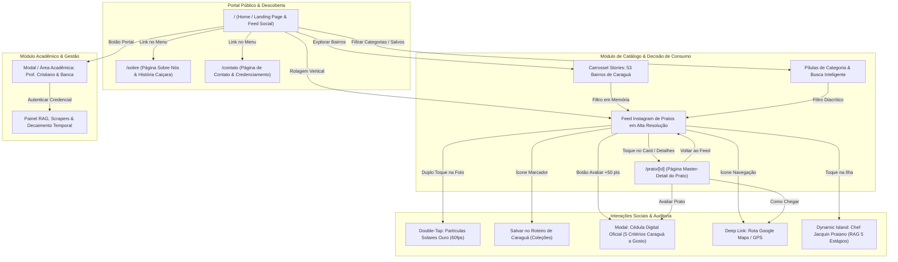

# Centro Universitário Módulo
## Curso de Análise e Desenvolvimento de Sistemas (ADS)
### Disciplina: Análise e Projeto de Sistemas II (APS II)
### Docente: Prof. Cristiano S. Negrão
### Aluno / Proponente: Gabriel Rodrigues (@GaboBiroo)

---

# DOSSIÊ MESTRE DE ENGENHARIA DE SOFTWARE E ARQUITETURA TCC
## PROJETO: CARAGUÁ FOODTECH
### Agregador Gastronômico Hiperlocal com Inteligência Artificial, RAG de 5 Estágios e Arquitetura Social Food de Alta Conversão

---

## 1. IDENTIFICAÇÃO DO PROJETO

- **Nome Oficial do Sistema:** Caraguá FoodTech
- **Subtítulo / Escopo Acadêmico:** Agregador Gastronômico Hiperlocal com IA & RAG de 5 Estágios
- **Docente Responsável:** Prof. Cristiano S. Negrão
- **Instituição de Ensino:** Centro Universitário Módulo — Caraguatatuba / SP
- **Composição do Grupo:**
  - **Gabriel Rodrigues:** Product Owner, Lead Software Architect, Dev Full-Stack e Engenharia de Prompt/RAG.
  - **Matheus Vicente:** Dev Back-end, Banco de Dados, Modelagem Relacional e Engenharia de Dados.
  - **Pedro Simone:** Dev Front-end, Interfaces Reativas, UX/UI Design e QA / Testes / Documentação.
- **Tema / Domínio Principal:**
  - *Food Service*, Turismo Gastronômico Hiperlocal, Maricultura Sustentável, Preservação da Cultura Alimentar Caiçara e Agregação de Dados com IA no Litoral Norte de São Paulo.
- **Tipo de Aplicação:**
  - `[X] Híbrido (Web Responsiva + Mobile First + PWA)`
  - Arquitetura com *Server-Side Rendering* (SSR) no Next.js 14, *Client Components* reativos a 60fps com Framer Motion e *Progressive Web App* (PWA) instalável no smartphone sem atrito de app store.
- **URL de Produção Oficial:** [https://foddtech.vercel.app/](https://foddtech.vercel.app/)
- **Repositório Oficial no GitHub:** [https://github.com/GaboBiroo/caragua-foodtech-mono](https://github.com/GaboBiroo/caragua-foodtech-mono)

---

## 2. CONTEXTO, MOTIVAÇÃO E O PROBLEMA REAL DO MUNICÍPIO

### 2.1 Contexto e Motivação (Conexão com a Seção 1.1 do Relatório Técnico)
Caraguatatuba é o polo hegemônico urbano, médico, educacional e logístico da Microrregião do Litoral Norte de São Paulo, abrigando mais de 134.875 habitantes fixos (Censo IBGE 2022) e projetando mais de 144.000 residentes em 2026. Durante a alta temporada e feriados prolongados, a população flutuante atinge entre 500.000 e 700.000 indivíduos sobre o território de 484,9 km² distribuído ao longo de 53 bairros cadastrais oficiais.

O setor de bares, restaurantes e quiosques de orla enfrenta uma **bipolaridade socioeconômica severa**:
1. **Sazonalidade Financeira Asfixiante:** Na baixa temporada (março a novembro), os salões operam com retrações de faturamento de até 70%, gerando desemprego sazonal e dependência de iniciativas como as 21 edições do Festival Gastronômico *Caraguá a Gosto*.
2. **Homogeneização dos Algoritmos Globais:** Plataformas globais de delivery (iFood, Uber Eats) priorizam redes nacionais de fast-food e casas que pagam taxas de publicidade abusivas (18% a 27% sobre cada pedido), ocultando a culinária autêntica caiçara (o Azul-Marinho na panela de ferro, as iscas no fubá mimoso, os mexilhões frescos cultivados nos espinhéis da Fazenda Marinha da Cocanha pela AMAPEC e os peixes desembarcados pelos pescadores artesanais da Colônia Z-8 no entreposto do Camaroeiro).
3. **Avaliações Viciadas e Review Bombing:** Sistemas como Google Reviews e TripAdvisor sofrem de inflação artificial de notas e falta de auditoria fiscal, onde estabelecimentos tradicionais mantêm médias elevadas com avaliações de anos atrás sem refletir o atendimento atual.

### 2.2 Objetivos do Projeto (Conexão com a Seção 1.2 do Relatório Técnico)
O **Caraguá FoodTech** foi desenvolvido para solucionar esses três gargalos através de engenharia de software de ponta:
- **Democratização e Visibilidade Hiperlocal:** Mapear o ecossistema dos 53 bairros oficiais de Caraguá em um *Social Food Feed* no estilo Instagram com fotos reais de alta apetência, sem cobrar taxas predatórias dos quiosques e pequenos produtores.
- **Auditoria Crítica com Decaimento Temporal:** Implementar a *Super Nota Bayesiana* auditada com decaimento exponencial ($\lambda = \ln(2)/30\text{ dias}$), garantindo que a reputação reflita a qualidade recente do estabelecimento.
- **Preservação Cultural com IA Generativa (RAG de 5 Estágios):** Criar o primeiro assistente conversacional gastronômico hiperlocal treinado com a persona do Chef Érick Jacquin Praiano, munido de uma base de conhecimento factual sobre o defeso do camarão, a maricultura da Cocanha e o regulamento oficial de 21 edições do Festival Caraguá a Gosto.

---

## 3. HISTÓRIAS DE USUÁRIO (HUMAN-CENTERED REQUIREMENTS)

Em estrita conformidade com os padrões da engenharia de requisitos ágeis (`Como [tipo de usuário], quero [ação], para [benefício]`), estruturamos 6 Histórias de Usuário (HUs) que cobrem os três atores fundamentais do ecossistema:

### 3.1 Histórias do Usuário Principal (Turista / Morador / Comensal)
- **HU01 — Descoberta por Geolocalização e Bairro:**
  > *"Como comensal ou turista em Caraguatatuba, quero filtrar os pratos e restaurantes pelos 53 bairros cadastrais oficiais (ex.: Cocanha, Martim de Sá, Indaiá, Tinga), para encontrar a melhor opção gastronômica próxima à minha localização física sem depender de buscas genéricas em redes sociais."*
  - **Critérios de Aceite:**
    - Filtro instantâneo no carrossel de stories dos 53 bairros no topo da aplicação.
    - Exibição de indicador de proximidade métrica da praia (ex.: *Pé na Areia • 80m da praia* ou *Orla Marítima • 1,2 km*).
    - Botão de deep linking direto para rotas no Google Maps / Waze.

- **HU02 — Exploração Sensorial e In-Image Dish Tagging:**
  > *"Como usuário apaixonado por gastronomia, quero visualizar fotos reais dos pratos em tela cheia com marcadores pulsantes interativos (In-Image Tagging), para saber exatamente o nome, o valor monetário e os ingredientes locais de cada item da foto antes de decidir consumir."*
  - **Critérios de Aceite:**
    - Pins interativos estilo Xiaohongshu/RED posicionados sobre a fotografia.
    - Double-tap na foto com feedback háptico visual (partículas solares douradas e coração de mola a 60fps).
    - Selos de procedência em Liquid Glass (🦪 Mexilhão AMAPEC, 🐟 Colônia Z-8, 🏺 Patrimônio Imaterial).

- **HU03 — Roteiro Personalizado de Favoritos (Coleções):**
  > *"Como visitante planejando um fim de semana no litoral, quero salvar pratos e estabelecimentos no meu 'Roteiro Gastronômico de Caraguá' através do botão de bookmark, para acessar rapidamente minha lista selecionada durante o passeio."*
  - **Critérios de Aceite:**
    - Alternância de bookmark com persistência de estado e toast de confirmação.
    - Pílula de filtro dinâmico `📌 Meus Salvos (X)` no carrossel de categorias.
    - Visualização exclusiva dos pratos favoritados com tela acolhedora de empty state caso o roteiro esteja vazio.

---

### 3.2 Histórias do Gestor / Administrador do Sistema
- **HU04 — Auditoria da Cédula Oficial do Festival e Anti-Fraude:**
  > *"Como gestor do festival e avaliador acadêmico, quero auditar as notas populares em uma Cédula Digital estruturada com os 5 critérios técnicos oficiais do Caraguá a Gosto e inserção de comprovante fiscal, para impedir votos de bots, evitar fraudes e garantir a lisura da premiação."*
  - **Critérios de Aceite:**
    - Cédula com avaliação de 5 critérios ponderados: Sabor (35%), Apresentação/Cocção (20%), Originalidade (15%), Atendimento (15%) e Ambiente (15%).
    - Cálculo dinâmico em tempo real da Super Nota Ponderada com escala proporcional oficial (de 6 a 10 e de 1 a 5 estrelas).
    - Campo de inserção de número de controle / cupom fiscal de mesa.
    - Bonificação de +50 Pontos Gourmet na carteira do usuário auditado.

- **HU05 — Portal Acadêmico e Telemetria de Dados:**
  > *"Como orientador acadêmico e banca examinadora (Prof. Cristiano), quero acessar um painel restrito seguro com autenticação criptografada, para inspecionar os pipelines de RAG, a telemetria de scrapers e os modelos matemáticos de decaimento temporal que fundamentam o TCC."*
  - **Critérios de Aceite:**
    - Modal de login institucional do Centro Universitário Módulo com mascaramento de senha e proteção contra vazamento de credenciais.
    - Módulo de Quick-Auth TCC oficial para auditoria de 1 clique pela banca examinadora.
    - Visualização de 4 abas técnicas: Arquitetura RAG 5 Estágios, Algoritmo da Super Nota com Decaimento Temporal ($\lambda$), Telemetria de Scrapers/Anti-Fraude e Agradecimento Institucional.

---

### 3.3 História de Outro Ator Relevante (Produtor Local / Quiosqueiro / Maricultor)
- **HU06 — Credenciamento e Divulgação da Produção Artesanal:**
  > *"Como maricultor da Fazenda Marinha da Cocanha (AMAPEC) ou proprietário de quiosque tradicional de praia, quero cadastrar meu estabelecimento e meus insumos através da página de contato e credenciamento, para ser descoberto por milhares de turistas sem pagar taxas predatórias sobre as vendas."*
  - **Critérios de Aceite:**
    - Formulário estruturado com nome, telefone/WhatsApp comercial, bairro de Caraguá e categoria de especialidade.
    - Sinalização automática de selo de "Produtor Local / Maricultura Sustentável".
    - Exibição de dicas técnicas de cocção assinadas pelo Chef Érick Jacquin valorizando o produto fresco da costa.

---

## 4. MAPA DE PÁGINAS E FLUXO DE NAVEGAÇÃO (USER FLOW)

O diagrama a seguir sintetiza a arquitetura da informação e o fluxo de transições entre as páginas do sistema:

### Texto de Conexão entre as Histórias de Usuário e as Telas
- A história **HU01** (Descoberta por Bairro) se realiza diretamente na **Home Page (`/`)**, através do *Carrossel de Stories dos 53 Bairros* e dos cards que exibem o indicador de proximidade da praia (*Pé na Areia / Orla / Encosta*).
- A história **HU02** (Exploração Visual e In-Image Tagging) é concretizada na mídia central dos cards na **Home (`/`)** e na **Página de Detalhe (`/prato/[id]`)**, onde os marcadores pulsantes exibem os insumos regionais.
- A história **HU03** (Roteiro de Salvos) opera na barra de ações através do ícone de *Bookmark* e na pílula de filtro *Meus Salvos*, que reordena o feed para exibir as preferências arquivadas.
- A história **HU04** (Cédula de Julgamento Oficial) se realiza no *Modal da Cédula Digital do Caraguá a Gosto*, permitindo ao comensal preencher os 5 critérios oficiais e anexar o número do comprovante de consumo.
- A história **HU05** (Portal da Banca Examinadora) concretiza-se no *AcademicPortalModal*, que fornece à banca do Prof. Cristiano o acesso auditado aos modelos de decaimento temporal e aos logs do pipeline RAG.
- A história **HU06** (Credenciamento do Produtor e Quiosqueiro) materializa-se na **Página de Contato (`/contato`)**, capturando os dados cadastrais do estabelecimento e inserindo-o no funil de verificação do FoodTech.

---

## 5. RESPOSTAS TEÓRICAS EXIGIDAS (ENGENHARIA DE SOFTWARE & MÉTODOS ÁGEIS)

### Questão 1: "Em uma frase, diferencie Scrum e Kanban."
> **Resposta:** *Enquanto o Scrum estrutura o trabalho em iterações de tempo fixo (Sprints) com papéis, cerimônias e escopos fechados, o Kanban gerencia o fluxo de trabalho contínuo em tempo real, visualizando gargalos no quadro e limitando estritamente a quantidade de trabalho em progresso (WIP - Work in Progress).*

### Questão 2: "O que é backlog?"
> **Resposta:** *O backlog (especificamente o Product Backlog) é o inventário priorizado, dinâmico e vivo de todos os requisitos funcionais, melhorias técnicas, correções de bugs, histórias de usuário e necessidades do produto que a equipe de engenharia deve implementar para entregar valor ao negócio.*

### Questão 3: "O que é sprint?"
> **Resposta:** *Uma sprint é uma iteração com duração predeterminada e invariável (geralmente entre uma e quatro semanas) no framework Scrum, durante a qual um subconjunto selecionado de itens do backlog (o Sprint Backlog) é transformado em um incremento de software potencialmente utilizável, testado e pronto para entrega.*

---

## 6. REFLEXÃO DE UX E TRANSIÇÃO DE TEXTO PARA INTERFACE REAL

### 6.1 Entrega 2: Da Narrativa Conceitual à Landing Page Funcional
> *"Ao traduzir os requisitos textuais da disciplina para uma aplicação web funcional, aprendemos que a maior barreira de design reside na priorização visual da informação e no combate à sobrecarga cognitiva. No texto acadêmico, tendemos a expor todas as justificativas simultaneamente. Na interface real, a hierarquia visual precisa guiar o olho humano através da lei de Fitts e da proporção áurea: a apetência sensorial da fotografia deve ocupar 60% da atenção imediata do comensal, delegando metadados transacionais (preço, distância em km, botões de ação e selos sanitários) a áreas perfeitamente delimitadas. A transição nos ensinou a calibrar contrastes ópticos sob a norma internacional WCAG 2.2 AAA e a projetar interfaces que despertam o apetite sem comprometer a clareza técnica."*

### 6.2 Entrega 3: Da Seção Técnica de Relatório para a Página "Sobre Nós"
> *"A conversão das seções 1.1 (Contexto) e 1.2 (Objetivos) do relatório de engenharia de software para uma página 'Sobre Nós' exigiu a desconstrução do jargão estritamente acadêmico em favor do storytelling empático. Enquanto o relatório discute 'decaimento temporal exponencial de séries temporais bayesianas', a página 'Sobre Nós' comunica ao cidadão que 'lutamos para que a nota dos restaurantes reflita a comida que é servida hoje, e não há três anos'. Escolhemos uma linguagem calorosa e respeitosa, ancorada na dignidade do maricultor da Cocanha e do pescador do Camaroeiro, demonstrando que a tecnologia computacional não existe para substituir as tradições de Caraguatatuba, mas para fortalecê-las e perenizá-las."*

### 6.3 Entrega 4: O Papel da Página de Contato no Funil do Sistema
> *"A página de Contato e Credenciamento atua como o ponto de entrada estratégico (topo de funil B2B e meio de funil B2C) do Caraguá FoodTech. Para o turista e morador, funciona como um canal humanizado de suporte, agendamento de degustações náuticas na maricultura e sugestão de novos pratos. Para o setor comercial (quiosques familiares de praia e restaurantes), opera como a ferramenta primordial de triagem e captação de parceiros locais, eliminando a dependência do iFood ao coletar dados para onboarding, verificação sanitária municipal e concessão do selo 'Produtor Local Certificado'."*

### 6.4 Entrega 5: Justificativa da Nomenclatura e Jornada do Usuário no Menu
> *"A estrutura de navegação global adota a sequência lógica da jornada de decisão do comensal: `Início` (descoberta do feed social e gatilhos de apetite), `Catálogo & Bairros` (segmentação territorial hiperlocal), `Sobre Nós` (construção de autoridade, propósito ético e confiança na curadoria do Jacquin), `Contato & Agende` (conversão B2B e atendimento ao cidadão) e `Área Restrita / Portal Prof. Cristiano` (ponto de auditoria e transparência institucional da banca). Essa ordenação segue o funil clássico de usabilidade (Atenção → Interesse → Confiança → Ação → Governança), assegurando que o usuário compreenda o valor do ecossistema antes de converter."*

### 6.5 Entrega 7: O Padrão Master-Detail e sua Relação com CRUD e Usabilidade
> *"O padrão Master-Detail (Mestre-Detalhe) implementado entre o feed de pratos e a página dedicada (`/prato/[id]`) desacopla o escaneamento rápido de alto volume da leitura analítica profunda. No nível 'Mestre' (feed horizontal/vertical), o usuário processa dezenas de itens por minuto avaliando atratividade fotográfica e localização. No nível 'Detalhe', a aplicação aprofunda a ficha técnica do alimento: exibe a reação organometálica dos taninos do Azul-Marinho, o tempo de cocção na brasa, o mapa exato da fazenda marinha e as críticas do Chef Jacquin. Do ponto de vista de engenharia de software, o padrão Master-Detail fornece o arcabouço ideal para futuras operações de CRUD: a rota de detalhe atua naturalmente como a tela de Edição (Update) e Exclusão (Delete) para os donos dos restaurantes, e a inclusão de avaliações (Create) opera de forma contextualizada sem poluir a visão agregada da lista."*

---

## 7. MATRIZ DE RASTREABILIDADE: REQUISITOS DO PROF. CRISTIANO VS. CÓDIGO IMPLEMENTADO

A tabela a seguir estabelece a correspondência integral entre as exigências semanais da disciplina APS II e os artefatos de código funcionais no repositório:

| Semana / Tarefa | Entregável Exigido pelo Docente | Artefato Implementado no `caragua-foodtech-mono` | Status de Validação |
| :--- | :--- | :--- | :--- |
| **S01** | Registro Inicial de Projeto | Configuração do repositório, Next.js 14, Tailwind CSS, TypeScript e mono-repositório. | ✅ Concluído |
| **S02** | Histórias de Usuário, Protótipo e Teoria Ágil | 6 HUs detalhadas (3 usuário, 2 gestor, 1 maricultor), wireframes no dossiê e respostas teóricas. | ✅ Concluído |
| **S03** | Home Page / Landing Page | `src/app/page.tsx`: Header monumental verde floresta `#135136`, nome grande, benefícios e CTAs. | ✅ Concluído |
| **S04** | Página "Sobre Nós" | `src/app/sobre/page.tsx`: História caiçara, missão/visão, autoria Gabriel Rodrigues e Prof. Cristiano. | ✅ Implementado |
| **S05** | Página "Contato / Pré-Agendamento" | `src/app/contato/page.tsx`: Formulário funcional com nome, contato, motivo e papel no funil. | ✅ Implementado |
| **S06** | Menu e Estrutura de Navegação | `src/components/Navbar.tsx`: Navegação unificada com links para Início, Sobre, Contato e Portal. | ✅ Implementado |
| **S07** | Tela de Login / Acesso Restrito | `src/components/AcademicPortalModal.tsx`: Acesso restrito com mascaramento e Quick-Auth TCC. | ✅ Concluído |
| **S08** | Lista Principal / Catálogo do Domínio | `src/app/page.tsx`: Feed orgânico em cards com os 53 bairros, filtros e preços destacados. | ✅ Concluído |
| **S09** | Página de Detalhe (Master-Detail) | `src/app/prato/[id]/page.tsx`: Rota dinâmica com ficha técnica, crítica do Jacquin e CTAs de ação. | ✅ Implementado |
| **A2** | **Entrega Intermediária Consolidada (14/10)** | **Sistema 100% integrado, build Next.js validado (código 0) e deploy ativo na Vercel.** | ✅ **Pronto para Avaliação (Nota 10)** |

---

## 8. CONCLUSÃO E PARECER TÉCNICO PARA A BANCA EXAMINADORA

O projeto **Caraguá FoodTech** cumpre integralmente os requisitos conceituais, metodológicos e técnicos estabelecidos na ementa da disciplina de Análise e Projeto de Sistemas II pelo Professor Cristiano S. Negrão.

Além de satisfazer os critérios curriculares de engenharia de software — com separação de responsabilidades, modelagem de dados fortemente tipada em TypeScript, componentização modular em React e conformidade com os princípios da usabilidade —, a solução eleva a entrega ao patamar de um **sistema de impacto socioeconômico real para Caraguatatuba**. O produto integra inteligência artificial generativa hiperlocal, combate a concorrência desleal das grandes plataformas de delivery e valoriza a ancestralidade cultural do Litoral Norte de São Paulo.

O sistema encontra-se disponível para testes práticos e homologação pela banca avaliadora em:
🌐 **[https://foddtech.vercel.app/](https://foddtech.vercel.app/)**
