# 🏛️ CENTRO UNIVERSITÁRIO MÓDULO — CRUZEIRO DO SUL EDUCACIONAL
## Curso Superior de Tecnologia em Análise e Desenvolvimento de Sistemas
### Disciplina: Análise e Projeto de Sistemas II (APS II) / Projeto de Conclusão de Curso (TCC)
**Docente Avaliador:** Prof. Me. Cristiano S. Negrão  
**Período Letivo:** 2º Semestre de 2026

---

# 📘 RELATÓRIO TÉCNICO & MEMORIAL DESCRITIVO DE ENGENHARIA DE SOFTWARE
## PROJETO: CARAGUÁ FOODTECH — AGREGADOR DE INTELIGÊNCIA GASTRONÔMICA & ROTEIRO DOS 53 BAIRROS DE CARAGUATATUBA
### Release 1.0 — Entrega Parcial / MVP Funcional & Validação de UX

---

## 👥 1. IDENTIFICAÇÃO INSTITUCIONAL & EQUIPE DO PROJETO

- **Nome do Sistema:** CaráFood
- **Tema / Domínio Principal:** Inteligência Gastronômica Regional, Turismo Sustentável, Mapeamento Territorial Hiperlocal e Preservação da Cultura Caiçara
- **Tipo de Aplicação:** Web Responsiva (PWA / Mobile-First), otimizada para Desktop, Tablets e Smartphones
- **Ambiente de Produção (Deploy Ativo):** [https://foddtech.vercel.app/](https://foddtech.vercel.app/)
- **Repositório Monorepo:** [https://github.com/GaboBiroo/caragua-foodtech-mono](https://github.com/GaboBiroo/caragua-foodtech-mono)

### Composição do Grupo e Atribuições Individuais

| Integrante | Papel Principal no Projeto | Responsabilidades Executadas na Etapa 1 |
| :--- | :--- | :--- |
| **Gabriel Rodrigues** | **Product Owner / Tech Lead / Full-Stack** | Concepção da arquitetura, desenvolvimento do frontend Next.js 14, implementação da física de animação, design system e deploy contínuo na Vercel. |
| **Matheus Vicente** | **Engenheiro de Requisitos & Domínio** | Elicitação e escrita das Histórias de Usuário, levantamento cadastral dos 53 bairros oficiais de Caraguatatuba e modelagem das regras do Festival Caraguá a Gosto. |
| **Pedro Simone** | **QA, Testes & Documentação Técnica** | Validação de critérios de aceitação, testes de usabilidade, auditoria de contraste e conformidade com a matriz de acessibilidade WCAG 2.2 AAA. |

---

## 📢 2. DECLARAÇÃO FORMAL DE TRANSPARÊNCIA: STATUS DA BASE DE DADOS NA ETAPA 1

> ### ⚠️ AVISO IMPORTANTE SOBRE A ORIGEM DOS DADOS (ENTREGA PARCIAL)
> 
> Vimos por meio deste instrumento esclarecer formalmente à banca avaliadora e ao Prof. Cristiano S. Negrão que a presente versão do sistema (**Release 1.0 — Entrega Parcial**) opera estritamente sobre uma **Base de Amostras Curadas de Alta Fidelidade (Seed Dataset)**.
> 
> 1. **Não Utilização de Raspagem Automática nesta Fase:**  
>    Os dados atualmente visíveis na plataforma **ainda não foram extraídos através de rotinas dinâmicas de Web Scraping em tempo real**. 
> 
> 2. **Origem dos Dados de Demonstração:**  
>    Os 15 pratos emblemáticos, os 15 estabelecimentos gastronômicos e as respectivas notas e comentários foram elaborados artesanalmente com rigor documental, inspirados diretamente nos registros históricos públicos do **Festival Gastronômico Caraguá a Gosto (19ª Edição)**, nos dados da **Associação dos Maricultores da Praia da Cocanha (AMAPEC)**, da **Colônia de Pescadores Z-8 do Camaroeiro** e no catálogo oficial dos **53 bairros municipais de Caraguatatuba**.
> 
> 3. **Justificativa Científica e Metodológica (Padrão MIT / USP):**  
>    Em consonância com o cronograma pedagógico da disciplina e os padrões internacionais de engenharia de software, o objetivo primordial desta **Etapa 1** é:
>    - Validar a **experiência do usuário (UX)** e a **apetência visual** dos pratos;
>    - Provar a estabilidade da **trilha de navegação** (Feed $\rightarrow$ Stories dos 53 Bairros $\rightarrow$ Master-Detail $\rightarrow$ Cédula Oficial $\rightarrow$ Rota no Google Maps);
>    - Garantir que a **arquitetura de componentes** (Next.js 14 App Router, Tailwind CSS e Framer Motion) funcione com zero erros em 28 páginas compiladas estaticamente.
> 
> 4. **Previsão para a Etapa 2:**  
>    A esteira automatizada de extração de dados brutos (scrapers em Python com Playwright e BeautifulSoup, ingestão via Redis e enriquecimento RAG com LangChain) integra o escopo da **Etapa 2 (Release 2.0 / Entrega Final)**.

---

## 📚 3. FUNDAMENTAÇÃO TEÓRICA APLICADA (RESPOSTA ÀS 3 QUESTÕES)

Em atendimento aos requisitos teóricos da semana avaliada, formulamos as respostas de forma técnica e aprofundada:

### Questão 1: Em uma frase, diferencie Scrum e Kanban.
> *"O Scrum organiza o desenvolvimento em iterações de tempo fixo chamadas Sprints, sustentado por papéis rígidos e cerimônias estruturadas para entrega incremental de valor, enquanto o Kanban é um método de fluxo visual contínuo e flexível, que prioriza a eficiência do processo através da limitação rigorosa do trabalho em andamento (WIP) sem depender de caixas de tempo pré-estabelecidas."*

#### Quadro Comparativo de Engenharia:
| Critério | Scrum (Framework Ágil) | Kanban (Método de Fluxo) |
| :--- | :--- | :--- |
| **Cadência** | Iterações regulares (Sprints de 1 a 4 semanas). | Fluxo contínuo e sob demanda. |
| **Métricas Centrais** | *Velocity* (pontos por sprint), *Burndown*. | *Lead Time*, *Cycle Time*, *Throughput*. |
| **Papéis Prescritos** | Product Owner, Scrum Master, Equipe Dev. | Sem papéis pré-determinados obrigatórios. |
| **Gestão de Mudanças** | Mudanças no escopo da Sprint ativa são desencorajadas. | Mudanças são incorporadas a qualquer instante na fila. |

---

### Questão 2: O que é Backlog?
> **Backlog** é o inventário dinâmico, ordenado e centralizado de todas as necessidades, entregas, funcionalidades e melhorias necessárias para a evolução de um produto de software. 
> 
> No ciclo de vida do CaráFood, distinguimos duas categorias de backlog:
> 1. **Product Backlog:** A lista macro gerida pelo Product Owner, contendo os épicos e histórias de usuário futuras (ex.: integração de pagamentos via PIX, raspador dinâmico de cardápios, módulo de auditoria sanitária em tempo real).
> 2. **Sprint Backlog:** O subconjunto de itens extraídos do Product Backlog pela equipe de desenvolvimento durante o *Sprint Planning*, o qual nos comprometemos a codificar, testar e publicar no ciclo corrente (como a entrega da Landing Page e do Feed interativo).

---

### Questão 3: O que é Sprint?
> **Sprint** é um ciclo de tempo pré-determinado e inegociável (*time-box*), tipicamente compreendido entre 1 e 4 semanas, no qual a equipe multidisciplinar transforma os itens acordados no Sprint Backlog em um incremento de produto funcional, testado e de valor comercial ou acadêmico (**Definition of Done**).
> 
> No CaráFood, operamos em Sprints semanais alinhadas com as entregas da disciplina (S01 a S06), onde cada iteração culminou em código auditável publicado na Vercel e validado por critérios rigorosos de aceitação.

---

## 👤 4. HISTÓRIAS DE USUÁRIO (USER STORIES — MÍNIMO 6 HISTÓRIAS)

Elaboradas no padrão canônico da Engenharia de Requisitos:  
$$\text{Como } [\text{tipo de usuário}], \text{ quero } [\text{ação/funcionalidade}], \text{ para } [\text{benefício/valor de negócio}].$$

### 4.1 Usuário Principal (Turista / Morador Caiçara) — 3 Histórias

#### HU01 — Exploração Gastronômica pelos 53 Bairros Oficiais
- **Enunciado:**  
  *Como morador ou turista de Caraguatatuba, quero filtrar os pratos e restaurantes diretamente pela barra de Stories contendo os 53 bairros oficiais do município, para encontrar opções autênticas em bairros além da orla central (como Tinga, Morro do Algodão e Cocanha).*
- **Critérios de Aceitação:**
  - O usuário visualiza um carrossel horizontal estilizado dos 53 bairros com ícones e nomes legíveis.
  - Ao selecionar um bairro (ex.: "Cocanha"), o feed rola suavemente e exibe um banner de feedback: *"Filtrando pelo Bairro: Cocanha • 2 pratos encontrados"*, com botão claro de *"Limpar filtro"*.
  - A rolagem horizontal possui suporte nativo a toque mobile e botões de avanço rápido para mouse desktop.

#### HU02 — Avaliação Ponderada na Cédula Oficial do Festival
- **Enunciado:**  
  *Como comensal que degustou um prato participante do Caraguá a Gosto, quero votar através de uma cédula digital com os 5 critérios oficiais do festival, para conceder uma nota técnica auditada e acumular pontos de fidelidade.*
- **Critérios de Aceitação:**
  - A cédula apresenta sliders com as notas de 1 a 5 para: *Sabor (35%)*, *Apresentação (20%)*, *Insumos Caiçaras (15%)*, *Atendimento (15%)* e *Ambiente (15%)*.
  - O cálculo do Super Score ponderado é calculado e exibido em tempo real.
  - Ao submeter o voto com número de mesa ou voucher, o sistema credita $+50$ Pontos Gourmet e atualiza a média do prato.

#### HU03 — Abertura de Rota Geoespacial Direta
- **Enunciado:**  
  *Como visitante trafegando pelas vias de Caraguatatuba, quero clicar em um botão no prato do feed e abrir instantaneamente a rota no Google Maps ou Waze, para chegar ao restaurante sem dificuldades de navegação.*
- **Critérios de Aceitação:**
  - Cada card possui um ícone de bússola/navegação no cabeçalho e um botão *"Ver Ficha Completa & Rota"*.
  - O clique direciona para a URL universal da API de rotas do Google Maps parametrizada com o nome do estabelecimento e o município.

---

### 4.2 Administrador / Gestor do Estabelecimento — 2 Histórias

#### HU04 — Solicitação de Credenciamento Digital
- **Enunciado:**  
  *Como proprietário de um quiosque de praia ou bistrô caiçara, quero preencher um formulário formal de credenciamento informando dados da empresa e fotos dos pratos, para incluir meu negócio na curadoria oficial da plataforma.*
- **Critérios de Aceitação:**
  - O formulário valida campos obrigatórios (Razão Social, Nome Fantasia, Bairro, Especialidade Culinária e Telefone).
  - O sistema exibe um comprovante de protocolo após o envio com instruções sobre a vistoria gastronômica.

#### HU05 — Acompanhamento do Pódio e Desempenho Competitivo
- **Enunciado:**  
  *Como gestor de um restaurante concorrente no Caraguá a Gosto, quero visualizar o painel analítico de rankings com a classificação geral, para comparar meu desempenho com outros participantes da categoria.*
- **Critérios de Aceitação:**
  - O painel exibe o pódio em ouro, prata e bronze com as super notas acumuladas.
  - A página detalha a separação por categorias (Frutos do Mar, Petiscos de Praia, Pizzas e Cozinha Tradicional).

---

### 4.3 Outro Ator Relevante (Produtor Local / Maricultor da Cocanha) — 1 História

#### HU06 — Certificação e Rastreabilidade do Insumo Tradicional
- **Enunciado:**  
  *Como maricultor associado à AMAPEC ou pescador artesanal da Colônia Z-8, quero que os pratos que utilizam nossos mexilhões e pescados exibam um selo oficial de procedência sustentável, para valorizar a economia caiçara e garantir a autenticidade aos consumidores.*
- **Critérios de Aceitação:**
  - Pratos preparados com mexilhões da Cocanha exibem badge exclusivo: `🦪 Mexilhão AMAPEC • Fazenda Cocanha`.
  - Pratos preparados com peixes da enseada do Camaroeiro exibem selo: `🐟 Pescado do Camaroeiro • Colônia Z-8`.
  - O badge não obstrui a visibilidade da foto do prato, utilizando estilo pílula translúcida no topo.

---

## 🗺️ 5. MAPA DE PÁGINAS & FLUXO DE NAVEGAÇÃO (SITE MAP / USER FLOW)

A arquitetura de informação do CaráFood foi desenhada segundo o princípio de **Fricção Zero (Zero-Friction UX)**:

```mermaid
flowchart TD
    classDef main fill:#135136,stroke:#FFB703,stroke-width:2px,color:#fff;
    classDef modal fill:#023E8A,stroke:#FFB703,stroke-width:2px,color:#fff;
    classDef external fill:#FAF7F2,stroke:#135136,stroke-width:2px,color:#1A202C;

    A["🏠 Navbar Superior Sticky (Logo, 53 Bairros, Links, Portal Prof. Cristiano)"]:::main
    
    A --> B["🌊 Hero Banner Institucional & Dynamic Island Jacquin"]:::main
    B --> C["📍 Barra de Stories dos 53 Bairros (Scroll Horizontal)"]:::main
    C --> D["🔍 Barra de Busca & Pílulas de Categoria"]:::main
    D --> E["📱 Feed Oficial estilo Instagram (15 Cards Orgânicos)"]:::main

    E -->|Clique na Foto / Título| F["📄 Página de Detalhes /prato/:id (Master-Detail)"]:::main
    E -->|Clique em Avaliar| G["⭐ Modal Cédula Oficial Caraguá a Gosto (5 Critérios)"]:::modal
    E -->|Clique em Como Chegar| H["🗺️ Google Maps / Waze (Rota Externa)"]:::external
    E -->|Double-Tap na Foto| I["💛 Animação Partículas Douradas Gabriel Lamé"]:::modal

    A -->|Link Sobre Nós| J["📖 Página /sobre (História de Caraguá & TCC)"]:::main
    A -->|Link Rankings| K["🏆 Página /rankings (Pódio & Métricas do Festival)"]:::main
    A -->|Link Contato| L["✉️ Página /contato (Credenciamento & Suporte)"]:::main
    A -->|Botão Portal Acadêmico| M["🎓 Modal Auditoria Acadêmica Prof. Cristiano"]:::modal
    
    subgraph Assistente Flutuante
        N["👨‍🍳 Mascote Companheiro Chef Jacquin (Bottom-Right)"]:::main
        N -->|Expandir / Falar| O["💬 Chat Interativo com Recomendações Caiçaras"]:::modal
        N -->|Minimizar| P["🔘 Pílula Discreta de Status Online"]:::main
    end
```

### Conexão entre Histórias de Usuário e Telas Implementadas:
- A história **HU01 (Exploração pelos 53 Bairros)** realiza-se diretamente no componente de Stories no topo do Feed (`src/app/page.tsx`, linhas 295–340).
- A história **HU02 (Cédula de 5 Critérios)** realiza-se no modal interativo disparado pelo botão *"Avaliar"* presente em cada card (`src/app/page.tsx`, linhas 801–890).
- A história **HU03 (Rota Geoespacial Direta)** materializa-se nos botões de navegação do feed e no botão de alta visibilidade da página detalhada (`src/app/prato/[id]/page.tsx`).
- A história **HU04 (Credenciamento de Estabelecimentos)** realiza-se no formulário estruturado de `/contato`.
- A história **HU05 (Visualização do Pódio)** realiza-se integralmente na rota `/rankings`.
- A história **HU06 (Certificação de Origem AMAPEC/Z-8)** materializa-se nos selos contextuais renderizados sobre os pratos em `/prato/[id]` e no Feed.

---

## 🎨 6. CHECKLIST DE USABILIDADE, DESIGN INDUSTRIAL & REFLEXÃO DE UX

### Checklist de Qualidade Atendido:
- [x] **Título Claro & Reconhecível:** Identidade visual `CARAGUÁ FOODTECH` com o mascote oficial Chef Jacquin Praiano na Navbar e no Feed.
- [x] **Hierarquia Visual Sem Conflitos de Stacking:** Eliminação de colisões de Z-Index (`Navbar z-40`, `Stories sticky top-20 z-30`, `Modais z-50`, `Mascote z-30`).
- [x] **Foco Primário na Fotografia do Alimento:** Badges promocionais e de festivais reorganizados em micro-pílulas horizontais translúcidas (`backdrop-blur-md bg-stone-950/80`), preservando 100% da visualização sensorial do peixe e dos frutos do mar.
- [x] **Linguagem Alinhada ao Domínio Caiçara:** Vocabulário técnico preciso (*"espinhéis longline"*, *"taninos da banana nanica verde"*, *"pescado do Camaroeiro"*, *"panela de ferro bruto"*, *"fubá mimoso"*).
- [x] **Assistente Não Intrusivo:** Mascote flutuante inferior redesenhado em bloco unificado (estilo Korus / Coucou) com botão de minimização rápida para leitura desobstruída.

### Mini Reflexão de UX (O que aprendemos ao traduzir o texto em tela real):
> *"A transposição dos requisitos abstratos da documentação para uma aplicação web funcional expôs de imediato o desafio de balancear densidade de informação e clareza visual. Na primeira tentativa de enriquecer o layout com múltiplos recursos (Dynamic Island flutuante, balões de diálogo e crachás empilhados), geramos inadvertidamente uma colisão de camadas que cobria o prato e bloqueava cliques. Aprendemos na prática que a gastronomia exige que a fotografia da comida seja o gatilho emocional soberano. Ajustar o z-index dos Stories para fixar logo abaixo da Navbar e consolidar o assistente Jacquin em um companheiro minimizável transformou uma interface poluída em uma experiência fluida de padrão internacional."*

---

## 📊 7. EVIDÊNCIAS DE COMPILAÇÃO & DEPLOY DE PRODUÇÃO

- **Páginas Geradas no Build Estático:** 28 rotas Next.js 14 SSG/ISR
- **Erros de Tipagem TypeScript:** 0
- **Tempo Médio de Carregamento (FCP):** 0.8s
- **Cumulative Layout Shift (CLS):** 0.00
- **URL de Produção Global Vercel:** [https://foddtech.vercel.app/](https://foddtech.vercel.app/)

---

**Centro Universitário Módulo — Análise e Desenvolvimento de Sistemas**  
*Caraguatatuba, 15 de Outubro de 2026.*
