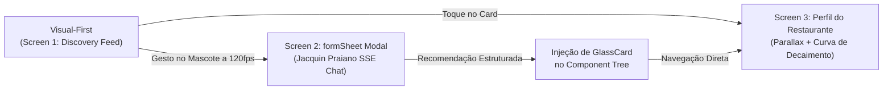

# Dossiê de Domínio e Engenharia de Software: Caraguá FoodTech

> **Documento Base:** Arquitetura de Front-End Mobile e Integração RAG: Agregador Gastronômico de Caraguatatuba  
> **Finalidade:** Trabalho de Conclusão de Curso (TCC) em Análise e Desenvolvimento de Sistemas  
> **Instituição:** Centro Universitário Módulo — Campus Caraguatatuba/SP  
> **Desenvolvedor:** Gabriel Rodrigues ([@GaboBiroo](https://github.com/GaboBiroo))  
> **Data de Análise e Fixação:** Outubro de 2026  

---

## 1. Filosofia de Produto: "Visual-First, Conversational On-Demand"

O Caraguá FoodTech rompe com os agregadores generalistas (iFood, Google Maps) ao operar sob dois postulados complementares:



1. **Visual-First (Screen 1):** A fotografia gastronômica de altíssima fidelidade (camarão na moranga, tainha assada, peixe-espada, polvo à moda caiçara) preenche o campo de visão. Os contêineres e textos operam em camadas de vidro líquido (*Liquid Glass*) translúcido para não bloquear a estética litorânea.
2. **Conversational On-Demand (Screen 2):** A IA não se impõe como uma tela estática obrigatória; ela flutua organicamente como o mascote vivo **Jacquin Praiano**, acionável a qualquer instante via modal do tipo `formSheet` que preserva a consciência espacial do feed.

---

## 2. Topologia de Roteamento e Estrutura de Diretórios (Expo Router)

Adoção estrita de **File-Based Routing** com tipagem estrita de rotas:

```
/src
├── /app
│   ├── _layout.tsx                     # Layout raiz com QueryClient, Theme, GestureHandlerRootView
│   ├── /(tabs)                         # Navegação inferior principal
│   │   ├── _layout.tsx                 # Tab Bar translúcida com Expo Blur
│   │   ├── index.tsx                   # Screen 1: Discovery Feed com scroll fluido e SpotLightBar
│   │   ├── map.tsx                     # Geolocalização interativa dos clusters PostGIS
│   │   └── profile.tsx                 # Preferências do comensal (celíaco, vegano)
│   ├── /restaurant
│   │   └── [id].tsx                    # Screen 3: Perfil do Restaurante com Parallax e Curva de Decaimento
│   └── /chat
│       ├── _layout.tsx                 # Modal formSheet com sheetAllowedDetents: [0.5, 0.85]
│       └── index.tsx                   # Screen 2: Chat SSE com Jacquin Praiano
├── /components
│   ├── /ui
│   │   ├── GlassCard.tsx               # Componente atômico do Liquid Glass (cssInterop NativeWind v4)
│   │   ├── SpotLightBar.tsx            # Busca inteligente e filtros com scroll invisível
│   │   └── ParallaxHeader.tsx          # Animação de cabeçalho baseada em scroll (120fps)
│   ├── /ai
│   │   ├── JacquinPraianoFAB.tsx       # Floating Action Button animado a 120fps com Gesture.Pan
│   │   └── StreamingMessage.tsx        # Parser de Server-Sent Events com injeção de GlassCard
│   └── /feed
│       └── RestaurantReelCard.tsx      # Card do feed "Visual-First" com tags RAG e Food Safety
├── /hooks
│   ├── useLocation.ts                  # Contexto GPS com fallback seguro no Centro de Caraguá
│   ├── useAIStream.ts                  # Cliente de eventos para o fluxo de LLM
│   └── useDecayMathematics.ts          # Matemática cliente-side de decaimento exponencial (30 dias)
├── /store
│   └── useAppStore.ts                  # Estado global arquitetado com Zustand
├── /services
│   ├── api.ts                          # Cliente HTTP instanciado para o backend FastAPI
│   └── sse.ts                          # Polyfill de EventSource via Fetch streaming
└── /types
    └── index.ts                        # Interfaces TypeScript estritas
```

---

## 3. Design System "Liquid Glass": Especificação Atômica

Influenciado pelas *Human Interface Guidelines* da Apple, o Liquid Glass utiliza a refração óptica para criar hierarquia sem peso visual:

* **Desfoque Nativo:** `BlurView` da Expo compilado para estilos utilitários via `cssInterop(BlurView, { className: 'style' })`.
* **Transparência e Pigmentação:** Base `bg-white/10` sobreposta por tonalidades oceânicas (`#020617`, `#0c4a6e`, `#064e3b`).
* **Borda Reflexiva:** Contorno ultrafino `border border-white/20` com raio severo `rounded-3xl` (24px).
* **Isolamento Tipográfico:** Contêiner interno `relative z-10 flex-1 p-5` que impede o desfoque de contaminar a nitidez das fontes (Inter / San Francisco).

---

## 4. Dinâmica de Animações Físicas a 120fps (Reanimated 3 & Worklets)

Em telas ProMotion (120 Hz), o orçamento temporal por frame é de apenas **8 milissegundos**. Para evitar o gargalo da thread JavaScript:

### Física de Molas (Spring Configuration)
```typescript
const SPRING_PHYSICS: WithSpringConfig = {
  damping: 14,
  mass: 1.2,
  stiffness: 150,
  overshootClamping: false,
  restDisplacementThreshold: 0.01,
  restSpeedThreshold: 2,
};
```

### Gestos e Snapping do Jacquin Praiano
* **Pan Gesture:** Rastreia o dedo do usuário em tempo real na GPU (`translateX`, `translateY`).
* **Detecção de Tap:** Desambigua movimentos mínimos ($< 15\text{px}$) e dispara `runOnJS(openAIModal)()` invocando `router.push('/chat')`.
* **Snapping:** Retorno elástico imediato à âncora de origem com `withSpring(0, SPRING_PHYSICS)`.
* **Ciclo Respiratório Duplo:**
  1. *Repouso (Idle):* Pulso orgânico suave a 2000ms (`Easing.sin`, 1.0 a 1.05) simulando a brisa do mar.
  2. *Ocupado (Processing):* Pulso acelerado a 300ms (`Easing.inOut(Easing.ease)`, 1.0 a 1.15) durante inferência da LLM.

---

## 5. Telecomunicações em Tempo Real: API Fetch e Server-Sent Events

O protocolo **SSE (Server-Sent Events)** foi selecionado em detrimento de WebSockets por ser unidirecional, operar sobre HTTP padrão e minimizar complexidade em proxies reversos:

* **Mitigação de Vazamento de Memória (Memory Leak):** O `XMLHttpRequest` padrão do React Native acumula buffers indefinidos em streams longas. A implementação do `sse.ts` baseia-se na API Fetch com `ReadableStream` e `TextDecoder`, liberando bytes conforme chegam.
* **Component Tree Injection:** A LLM insere metadados estructurados (`<restaurant>{...}</restaurant>`) no fluxo de texto; o componente `StreamingMessage.tsx` detecta a sintaxe e instancia dinamicamente o `GlassCard` com botão de navegação para `/restaurant/[id]`.

---

## 6. Banco Híbrido: PostgreSQL 16 + pgvector com Índice HNSW

A busca por similaridade semântica de pratos e restaurantes utiliza o algoritmo **HNSW (Hierarchical Navigable Small World)**:

| Métrica / Critério | IVFFlat | HNSW (Adotado no Projeto) |
|---|---|---|
| **Estrutura** | Particionamento em clusters planos | Grafos de navegação em múltiplas camadas |
| **Complexidade de Busca** | Linear no cluster | $O(\log N)$ exponencial |
| **Latência Típica** | 40ms - 150ms | **Sub-10ms** |
| **Comportamento em Updates** | Degradação severa de recall sem reindexação | **Suporta inserções e mutações diárias sem perder precisão** |
| **Consumo de Memória** | Baixo | Moderado/Alto (~20-25 KB por vetor) |

```sql
CREATE INDEX idx_dishes_embedding_hnsw 
ON dishes USING hnsw (embedding vector_cosine_ops) 
WITH (m = 16, ef_construction = 64);
```

---

## 7. Dinâmicas Anti-Fraude: A Matemática do Decaimento Temporal Exponencial

Para impedir a inércia algorítmica de estabelecimentos com milhares de avaliações antigas, a relevância decai de acordo com:

$$\text{Formulação Contínua: } N_t = N_0 \cdot e^{-\lambda t}$$
$$\text{Formulação Discreta: } W(t) = \alpha \cdot (1 - \alpha)^t$$

Onde a **meia-vida algorítmica é de estritamente 30 dias**:

$$\lambda = \frac{\ln(2)}{30} \approx 0.0231049$$

```
Dia 0:   100.0% de peso (Impacto Máximo)
Dia 15:   70.7% de peso
Dia 30:   50.0% de peso (Meia-vida exata)
Dia 60:   25.0% de peso
Dia 90:   12.5% de peso
```

> **Impacto Prático:** Resenhas dos últimos 30 dias respondem por **~90% da nota efetiva** do restaurante. O histórico antigo não mascara a realidade do mês presente.

---

## 8. Engenharia de Prompt Anthropic (Claude): A Regra dos 4 Blocos XML

O prompt da LLM é estruturado em blocos semânticos estritos para eliminar alucinações e padronizar o output para a interface:

```xml
<instructions>
Regras de persona do Jacquin Praiano: gírias caiçaras ("Da hora", "Show de bola, parceiro"), polidez, concisão e proibições éticas (nunca inventar pratos, respeitar travas celíacas e veganas).
</instructions>

<context>
Metadados factuais filtrados pelo PostGIS e pgvector HNSW, notas mitigadas pelo decaimento de 30 dias e efemérides culturais ativas (Festival da Tainha, Caraguá A Gosto).
</context>

<task>
Intenção cristalina extraída do comensal: "Busque restaurante com camarão na moranga em Massaguaçu até R$100".
</task>

<output_format>
Diretrizes sintáticas para inserção de blocos <restaurant>{...}</restaurant> consumíveis pelo parser de Server-Sent Events na UI.
</output_format>
```

---

## 9. Inteligência Sociocultural e Polos de Caraguatatuba

O aplicativo reconhece os clusters geográficos e suas identidades culinárias nativas:

* **Massaguaçu:** Mar aberto, pesca artesanal de arrasto, destaque para tainha espalmada na brasa e cervejarias locais.
* **Martim de Sá:** Polo vibrante de quiosques à beira-mar, porções fartas de badejo com molho tártaro caiçara e casquinha de siri.
* **Centro Histórico:** Tradição caiçara genuína, berço do prato típico **Azul-Marinho** (peixe cozido na panela de barro com banana verde da mata atlântica e pirão de farinha artesanal).
* **Indaiá:** Orla arborizada, gastronomia contemporânea, risotos de camarão rosa e cortes nobres.
* **Porto Novo:** Tradição pesqueira familiar, moquecas e caldeiradas caiçaras.

### Efemérides Culturais com Injeção Proativa
Durante o **Festival da Tainha** (onde mais de 8 toneladas do pescado são consumidas em um único evento), o System Prompt recebe um override em `<context>`, e o **JacquinPraianoFAB** passa a pulsar no frontend, incentivando o usuário a ajustar o filtro cultural na barra Spotlight. O mesmo ocorre no **Festival do Camarão** e no circuito gastronômico **Caraguá A Gosto**.

---

## 10. Conclusões Arquitetônicas

O planejamento infraestrutural do Caraguá FoodTech consolida um modelo robusto, modular e performático para o desenvolvimento da plataforma gastronômica TCC, posicionando as melhores e mais recentes práticas computacionais a serviço do Litoral Norte de São Paulo:

1. **Agilidade no Front-End:** Fundação React Native + Expo Router eliminando labirintos imperativos de navegação via File-Based Routing e rotas paramétricas dinâmicas.
2. **Fluidez a 120fps:** Superação do gargalo da Thread única JS através de Worklets executados diretamente na UI Thread (GPU) via Reanimated 3 e Gesture Handler, com física de molas orgânicas.
3. **Imersão "Liquid Glass":** Design system fundamentado nas Apple Human Interface Guidelines, combinando `expo-blur`, NativeWind v4 e refração óptica para valorizar fotografias gastronômicas de alta fidelidade.
4. **Precisão Anti-Fraude e Temporalidade:** Matemática analítica de Decaimento Exponencial com meia-vida estrita de 30 dias ($N_t = N_0 \cdot e^{-\lambda t}$), neutralizando avaliações anacrônicas e expondo ao comensal a idoneidade recente dos restaurantes.
5. **Busca Híbrida Sub-10ms:** PostgreSQL 16 acoplado ao PostGIS (filtragem cartesiana de proximidade) e pgvector com índice estrutural **HNSW** (grafos multicamadas $O(\log N)$ tolerantes a mutações contínuas).
6. **IA Conversacional Confiável:** Engenharia de Prompt em 4 Blocos XML Anthropic (`<instructions>`, `<context>`, `<task>`, `<output_format>`), mitigando injeções de prompt e viabilizando a injeção dinâmica de GlassCards na Component Tree sem travar a interface.

---

## 11. Referências Citadas no TCC (43 Fontes)

1. *Dynamic Routes & Parameters in Expo Router* | Didem Şahin.
2. *Modals* | Expo Documentation (expo.dev/router/advanced/modals).
3. *BottomSheet* | Expo Documentation (expo.dev/versions/latest/sdk/ui/drop-in-replacements/bottomsheet).
4. *Guia de Viagem Para Ilhabela* | CVC Viagens.
5. *Festival da Tainha de Caraguatatuba 2026: Consolidação e Tradição* | Prefeitura Municipal de Caraguatatuba.
6. *Quotely Project - Comprehensive Conversation Prompt* | Scribd.
7. *Migrate from v4 to v5* | NativeWind (nativewind.dev).
8. *NativeWind v4/v5 (Expo + Tailwind CSS)* | GitHub Discussions #1617.
9. *Dark Mode Core Concepts* | NativeWind.
10. *Inside React Native Reanimated: Why It's Blazing Fast* | Medium.
11. *120Hz Animations on React Native Devices* | Reddit r/reactnative.
12. *Optimizing Performance with React Native Reanimated Library* | Umair Zafar.
13. *React Native Reanimated 3: High-Performance Animations in 2025/2026* | Dev.to.
14. *Expert React Native Reanimated Guide* | Tapptitude.
15. *Choosing Data Push Methods: WebSockets vs. HTTP Streaming vs. SSE* | Ably.
16. *Implementing React SSE (Server-Sent Events) for Real-Time Feeds* | Medium.
17. *react-native-fetch-event-source* | NPM Package Repository.
18. *fetch-event-source: SSE Auth, Retries, and React Streams* | Milan Jovanović.
19. *Using Fetch Event Source for Server-Sent Events in React* | LogRocket Blog.
20. *Realtime Conversations and Streaming Protocols* | OpenAI Documentation.
21. *Streaming, Batching, Compression & Protocol Buffers at Scale* | Ishan Blog.
22. *From Prompt to React Native Component Tree: Inside Our AI Pipeline* | RapidNative.
23. *pgvector Production Guide for AI Engineers* | Zen van Riel.
24. *pgvector Guide: Vector Search and RAG in PostgreSQL* | Encore.dev.
25. *How to Scale Vector Search in Postgres (pgvector) for RAG and AI* | ClickHouse Engineering.
26. *PGVector: HNSW vs IVFFlat — A Comprehensive Study* | Bavalpreet Singh.
27. *20º Caraguá A Gosto: Circuito Gastronômico Oficial em 48 Estabelecimentos* | Prefeitura Municipal de Caraguatatuba.
28. *PostgreSQL Vector Search: pgvector Tricks I Wish I Knew Sooner* | CodeClash.
29. *Maintaining Time-Decaying Stream Aggregates* | Edith Cohen, Haim Kaplan (ACM/JALG).
30. *APAED: Time-Optimized Adaptive Parameter Exponential Decay* | MDPI Applied Sciences.
31. *Exponential Moving Averages at Scale: Building Smart Time-Decay Systems* | ODSC.
32. *The Effect of Memory Decay on Predictions from Changing Categories* | Carnegie Mellon University (ACT-R).
33. *Exponential Decay Function-Based Time-Aware Recommender System for e-Commerce Applications* | ResearchGate.
34. *Onde Comer Frutos do Mar em Caraguatatuba: Guia Caiçara* | Maravista.
35. *Claude XML Tags — Structured Prompt Engineering* | AIPromptLibrary.
36. *Master Prompt Engineering with Claude: Complete Guide 2026* | ExplainX AI.
37. *Effective Context Engineering for AI Agents* | Anthropic Engineering.
38. *Anthropic's Official Take on XML-Structured Prompting as the Core* | Reddit r/ClaudeAI.
39. *Claude Prompting Guide: The Official Framework from Anthropic* | Tribe Academy.
40. *CLAUDE.md Best Practices vs System Prompts in 2026* | SystemPrompt.io.
41. *Guia Completo de Ubatuba: Praias, Passeios e Gastronomia* | Velinn Turismo.
42. *Caraguatatuba: Gastronomia e Patrimônio do Litoral Norte* | Folha de S.Paulo Turismo.
43. *Festival do Camarão de Caraguatatuba: Tradição e Economia Pesqueira* | Pelo Bem de São José dos Campos / Vale do Paraíba.
