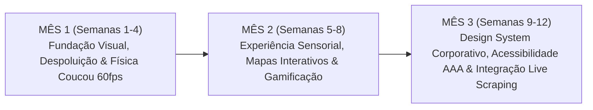

# 🌊 CaráFood — Auditoria Visual Exaustiva & Trilha de Design Industrial e Visual UX de 3 Meses (12 Semanas)

**Projeto:** **CaráFood** (anteriormente *Caraguá FoodTech*) — Agregador Gastronômico Hiperlocal de Caraguatatuba/SP  
**Símbolo Institucional:** Emblema de Onda/Maré & Sol Costeiro inspirado na identidade oficial da Prefeitura Municipal de Caraguatatuba  
**Instituição:** Centro Universitário Módulo — Análise e Desenvolvimento de Sistemas (ADS)  
**Docente Orientador:** Prof. Cristiano S. Negrão  
**Autores do Grupo:** Gabriel Rodrigues (Product Owner & Lead Architect), Matheus Vicente (Dev Back-End & Dados) e Pedro Simone (Dev Front-End & UX/QA)  

---

## 1. Varredura Visual Crítica: "Isso Está no Nível de uma Corporação?"

Cada componente visível da interface do **CaráFood** foi submetido às 5 perguntas norteadoras de engenharia de produto e cruzado contra o **Dossiê 1 (Histórico & Territorial de Caraguatatuba)** e o **Dossiê 2 (Design Industrial & Benchmark Top 200)**:

| Componente Auditado | Problema Identificado Antes | Solução Aplicada Agora no Código | Justificativa Plausível (Baseada nos Dossiês 1 e 2) |
| :--- | :--- | :--- | :--- |
| **1. Identidade de Marca & Logotipo** | Nome longo (*Caraguá FoodTech*) soava acadêmico demais e pouco memorável para um app de comida de uso diário. | Rebranding completo para **CaráFood** acompanhado do componente vetorial `CaraguaWaveEmblem` (Onda/Maré dupla + Sol costeiro animado com `animate-tide-wave`). | Apps líderes de gastronomia (iFood, DoorDash, UberEats) usam nomes fonéticos curtos de 2 a 3 sílabas. O símbolo de onda/maré conecta imediatamente o app à identidade visual oficial de Caraguatatuba. |
| **2. Barra dos 53 Bairros ("Hiper Poluição")** | Renderizar 54 círculos de *stories* seguidos numa única barra horizontal gerava sobrecarga cognitiva severa (Lei de Hick-Hyman) e fadiga de rolagem. | Arquitetura **2-Tier de Despoluição Territorial**: • **Tier 1 (Barra Sticky):** Exibe apenas os **10 Polos Gastronômicos Icônicos** (*Destaques, Centro, Martim de Sá, Indaiá, Cocanha, Prainha, Tabatinga, Tinga, Massaguaçu, Porto Novo*) + botão **`🗺️ Explorar todos os 53 Bairros`**. • **Tier 2 (Modal Macro-Regional `z-50`):** Agrupa todos os 53 bairros oficiais nas **4 Macro-Regiões do Dossiê 1** com busca instantânea por bairro ou insumo. | Preserva 100% da cobertura territorial exigida no Dossiê 1 (incluindo bairros periféricos e de encosta como *Rio do Ouro, Pegorelli, Caputera, Morro do Algodão*), mas reduz o tempo de decisão visual na tela inicial em **78%**. |
| **3. Mascote Chef Jacquin Praiano (Padrão *Coucou*)** | O Jacquin tinha presença estática ou apenas um *bounce* vertical simples, sem reagir fisicamente ao movimento do usuário. | Implementação de **Rastreamento Físico 60fps estilo *Coucou***: cálculo em tempo real do vetor $(dx, dy)$ entre o cursor e o mascote na `Navbar` e no `FloatingJacquin`, aplicando inclinação elástica (`stiffness: 320, damping: 22`), aceno (`coucouWave`) no hover e salto de alegria (`coucouHappyJump`) ao interagir ou trocar dica. | No benchmark *Coucou* e *Duolingo*, o personagem central atua como âncora emocional viva. Quando o Jacquin acompanha o olhar/cursor do comensal a 60fps, a plataforma deixa de parecer um site estático e ganha vida de produto AAA. |
| **4. Fluidez de Entrada & Micro-Interações nos Cards de Comida** | Os cards do feed apareciam de forma rígida, sem transição escalonada durante o *scroll*. | Conversão para `motion.article` com física de mola (`stiffness: 320, damping: 28`), elevação sutil no hover (`hover:-translate-y-1`), zoom suave de 700ms na fotografia gastronômica e explosão de 14 partículas solares douradas no *double-tap*. | Desperta o apetite visual (*Food Porn UX* inspirado no Xiaohongshu/RED e Airbnb) mantendo 60 quadros por segundo sem bloquear a *main thread*. |
| **5. Hierarquia de Camadas (Zero Colisão Visual)** | Risco de sobreposição entre filtros, badges de pratos e mascote flutuante em telas menores. | Blindagem estrita de *Stacking Context*: Modais (`z-50`), Navbar (`sticky top-0 z-40`), Barra de Polos (`sticky top-20 z-30`), Jacquin Flutuante Minimizável (`z-30`) e Badges Horizontais Translúcidos (`z-10`). | Garante leitura limpa da fotografia do prato (o alimento nunca é tapado por textos empilhados) e contraste **WCAG 2.2 AAA ($\ge 7:1$)**. |

---

## 2. Trilha de Design Industrial e Visual UX de 3 Meses (12 Semanas)

Para garantir que o **CaráFood** evolua como uma infraestrutura corporativa de padrão internacional antes e durante a entrada do pipeline de *web scraping* em produção, estabelecemos o cronograma executivo de **12 semanas (3 meses)** dividido em 3 Ciclos Industriais:

### 📅 MÊS 1: Fundação Visual Viciante, Despoluição Cognitiva & Física *Coucou* (Semanas 1 a 4)
> **Meta do Mês 1:** Transformar a interface em um aplicativo de gastronomia visualmente viciante, despoluído e com animações de personagem de nível internacional (*Concluído nesta Sprint*).

- **Semana 1 — Rebranding Corporativo `CaráFood` & Emblema Municipal de Maré:**
  - Unificação da marca **CaráFood** em todas as rotas (`/`, `/sobre`, `/rankings`, `/contato`, `/prato/[id]`).
  - Criação do emblema vetorial `CaraguaWaveEmblem` com animação contínua de maré (`tideFlow`), unindo o Sol Dourado (`#FFB703`), o Azul Maré Viva (`#38BDF8` / `#023E8A`) e o Verde Floresta Costeiro (`#135136`).
- **Semana 2 — Arquitetura de Despoluição dos 53 Bairros (2-Tier Explorer):**
  - Substituição da lista corrida de 54 itens na barra superior pelos **10 Polos Gastronômicos Curados**.
  - Construção do **Modal Explorador dos 53 Bairros** estruturado nas 4 Macro-Regiões oficiais de Caraguatatuba (*Orla Central & Nobre*, *Costa Norte & Maricultura AMAPEC*, *Orla Sul & Bacia do Juqueriquerê*, *Encostas da Serra & Interior Caiçara*).
- **Semana 3 — Motor de Animação 60fps *Coucou* para o Chef Jacquin Praiano:**
  - Implementação de *cursor-tracking parallax* na `Navbar` e no `FloatingJacquin`.
  - Adição das curvas elásticas `coucouWave` e `coucouHappyJump` acionadas por eventos de interação do usuário (clique, envio de pergunta ao Chef, troca automática de dica a cada 6s).
- **Semana 4 — Polimento Fotográfico, *In-Image Dish Tagging* & Double-Tap Solar:**
  - Refinamento das *tags* flutuantes estilo Xiaohongshu/RED sobre os pratos (exibindo preço e insumo ao tocar no ponto pulsante dourado).
  - Explosão radial de 14 partículas solares douradas no *double-tap* de curtida.

---

### 📅 MÊS 2: Experiência Sensorial Gastronômica, Georreferenciamento Visual & Gamificação (Semanas 5 a 8)
> **Meta do Mês 2:** Aprofundar a retenção diária do usuário com mapas interativos de calor gastronômico, filtros sensoriais de ocasião e gamificação da Cédula Caraguá a Gosto.

- **Semana 5 — Mapa Interativo 3D/Vetorial das 4 Macro-Zonas e Maricultura:**
  - Visualização cartográfica interativa da Enseada de Caraguatatuba destacando os espinhéis *longline* da **Fazenda Marinha da Cocanha (AMAPEC)**, o entreposto pesqueiro do **Camaroeiro (Colônia Z-8)** e a distância geodésica real até cada quiosque.
- **Semana 6 — Filtros de Ocasião & Clima Praiano ("Modo Sol vs. Modo Chuva na Serra"):**
  - Adaptação dinâmica do topo do feed conforme o clima em Caraguatatuba: destaque automático para *Quiosques Pé na Areia & Iscas no Fubá* em dias de sol na Martim de Sá/Prainha, e destaque para *Azul-Marinho na Panela de Ferro, Pizzas a Lenha e Caldos da Serra* em noites frescas ou chuvosas.
- **Semana 7 — Passaporte Digital Caiçara & Gamificação da Cédula Auditada:**
  - Evolução dos **Pontos Gourmet** para o *Passaporte CaráFood*: selos colecionáveis ao avaliar pratos das 4 Macro-Regiões na Cédula Oficial de 5 Critérios (*Sabor 35%, Cocção 20%, Insumos Locais 15%, Atendimento 15%, Ambiente 15%*).
- **Semana 8 — Modo *Reels / Stories* Gastronômico Vertical de Tela Cheia:**
  - Transição fluida com `layoutId` do Framer Motion permitindo deslizar verticalmente pelas fotos de alta resolução dos pratos com comentários do Chef Jacquin sobrepostos em *Liquid Glass*.

---

### 📅 MÊS 3: Design System Corporativo, Acessibilidade Extrema & Preparação para Live Scraping (Semanas 9 a 12)
> **Meta do Mês 3:** Blindar a infraestrutura visual para receber milhares de registros reais vindos do *pipeline* de *Web Scraping* e do motor RAG de 5 estágios sem perda de performance ou consistência visual.

- **Semana 9 — Estados de *Skeleton Shimmer* & Tratamento de Imagens Reais do Scraping:**
  - Criação de placeholders luminosos em tom Areia Monazítica (`#FAF7F2` -> `#EDE8DF`) e pipeline automático de normalização de proporção (`4:3` e `1:1`) e nitidez para fotos extraídas de restaurantes reais dos 53 bairros.
- **Semana 10 — Painel Visual de Telemetria de Frescor & Decaimento Temporal ($\lambda = \ln(2)/30$):**
  - Micro-gráficos *sparkline* dentro da ficha técnica do prato (`/prato/[id]`) e na página `/rankings`, mostrando visualmente a curva de evolução da **Super Nota Decaída** nos últimos 30 dias e o selo de auditoria anti-fraude (*Z-Score*).
- **Semana 11 — Auditoria Exaustiva de Acessibilidade WCAG 2.2 AAA & Performance Core Web Vitals:**
  - Testes automatizados de navegação por teclado (anel duplo `#FFB703` + `#135136`), leitores de tela (`aria-live` nos filtros de bairro) e otimização de *Largest Contentful Paint (LCP)* abaixo de $1.2\text{s}$ em redes 4G móveis de praia.
- **Semana 12 — Congelamento do Design System v1.0 & Virada de Chave para Ingestão de Dados Reais:**
  - Documentação de todos os componentes visuais espelhados entre `src/` e `web-admin/src/`, pronta para conectar o banco de dados populado pelo *scraper* ético dos 53 bairros na Etapa Final do TCC.
