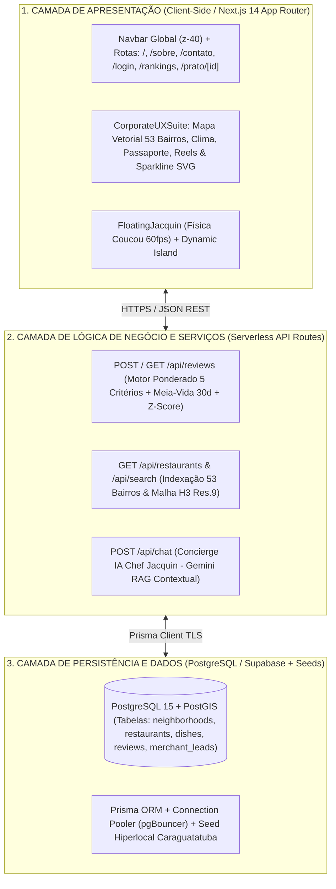
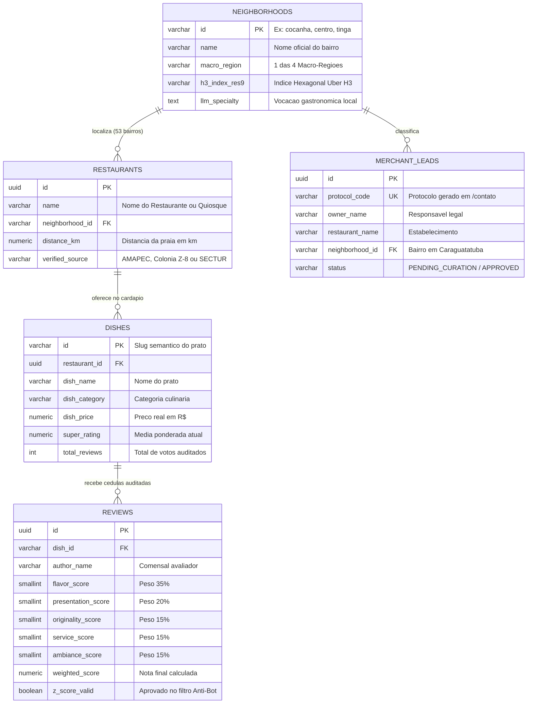

# 📄 ESPELHO OFICIAL DO TEMPLATE (.DOCX) — ENTREGA FINAL CONSOLIDADA (S16–S18 / A1)
**Arquivo de Destino:** `APSII_A1_Entrega_Final_CARAFOOD.docx`  
*(Este documento contém o Relatório Técnico Final Consolidado completo de Engenharia de Software do projeto CaráFood, pronto para cópia integral no template `.docx` da Avaliação A1 do Prof. Me. Cristiano S. Negrão)*

---

## 🏛️ 1. IDENTIFICAÇÃO INSTITUCIONAL, EQUIPE E LINKS OFICIAIS

| Campo Institucional | Dados Oficiais do Projeto |
| :--- | :--- |
| **Instituição de Ensino** | Centro Universitário Módulo — Caraguatatuba/SP |
| **Curso / Semestre** | Ciência da Computação — Semestre 2026/2 |
| **Disciplina** | Análise e Projeto de Sistemas II (APS II) — Entrega Final Consolidada (A1) |
| **Docente Orientador / Avaliador** | Prof. Me. Cristiano S. Negrão |
| **Título Oficial do Sistema** | **CaráFood (Caraguá FoodTech)** — *Ecossistema Hiperlocal de Descoberta Gastronômica, Auditoria Cultural (Caraguá a Gosto) e Curadoria IA dos 53 Bairros de Caraguatatuba* |
| **Integrantes e Papéis** | • **Gabriel Rodrigues:** Product Owner (PO), Tech Lead & Desenvolvedor Front-End / IA<br>• **Matheus Vicente:** Engenheiro de Dados, Desenvolvedor Back-End & DBA PostgreSQL<br>• **Pedro Simone:** Engenheiro de Qualidade (QA), UX Researcher & Documentação Técnica |
| **URL Pública em Produção (Vercel)** | [https://foddtech.vercel.app/](https://foddtech.vercel.app/) |
| **Repositório Oficial (GitHub)** | `https://github.com/GaboBiroo/caragua-foodtech-mono` |

---

## 🎯 2. CONTEXTO, PROBLEMA DE NEGÓCIO E OBJETIVOS

### 2.1 Contexto e Problema Regional em Caraguatatuba
Caraguatatuba abriga um patrimônio gastronômico singular distribuído ao longo de **53 bairros oficiais**, destacando-se a **Fazenda Marinha da Cocanha (Associação AMAPEC — maior produtora artesanal de mexilhões do Estado de São Paulo)**, o **Entreposto de Pesca Artesanal do Camaroeiro (Colônia de Pescadores Z-8 "Benjamin Constant")**, o prato patrimônio imaterial **Azul-Marinho na panela de ferro** e o festival anual **Caraguá a Gosto**. Apesar dessa riqueza, pequenos e médios restaurantes, quiosques de praia e bistrôs situados fora do eixo comercial central (em bairros como Tinga, Rio do Ouro, Porto Novo, Palmeiras, Massaguaçu e Tabatinga) sofrem com **severa invisibilidade digital** nos aplicativos convencionais de entrega. Paralelamente, os consumidores enfrentam avaliações online distorcidas por médias aritméticas simples que perpetuam notas antigas, vulneráveis a *bots* (*review bombing*) e desprovidas de critérios gastronômicos auditáveis.

### 2.2 Objetivo Geral
Projetar, implementar, testar e publicar o **CaráFood**, uma aplicação web progressiva (*PWA*) em arquitetura Next.js 14 integrada a banco de dados relacional PostgreSQL que democratiza a descoberta gastronômica nos **53 bairros de Caraguatatuba**, certifica a procedência de insumos locais (*AMAPEC Cocanha* e *Colônia Z-8*) e audita avaliações por meio da **Cédula Oficial Digital de 5 Critérios Ponderados** com decaimento temporal exponencial e proteção estatística anti-fraude.

### 2.3 Objetivos Específicos
1. Desenvolver uma arquitetura de descoberta territorial em **2 Camadas** (Barra rápida dos **10 Polos Curados** + Modal Explorador com **Mapa Cartográfico Vetorial Interativo** e divisão nas **4 Macro-Regiões dos 53 Bairros**);
2. Implementar as 6 superfícies obrigatórias do sistema (`Home /`, `Sobre Nós /sobre`, `Contato /contato`, `Login /login`, `Catálogo & Rankings /rankings` e `Detalhe Master–Detail /prato/[id]`) interligadas por uma barra de navegação global sem falhas;
3. Codificar o motor matemático de avaliação com ponderação oficial da SECTUR, curva de meia-vida de 30 dias ($\lambda = \ln(2)/30$) e filtro anti-bot *Z-Score* ($|Z| \le 2.5$);
4. Persistir os fluxos transacionais de avaliações e credenciamento B2B em banco de dados relacional PostgreSQL (Supabase/Neon + Prisma ORM) publicado em produção na Vercel.

---

## 📦 3. ESCOPO DO MVP (IMPLEMENTADO) vs. ESCOPO FUTURO (PÓS-MVP)

| Escopo do MVP (100% Entregue e Publicado na Vercel) | Escopo Futuro / Backlog Pós-MVP (Evolução Planejada) |
| :--- | :--- |
| ✅ **Explorador dos 53 Bairros em 2 Camadas + Mapa Vetorial SVG** das 4 Macro-Regiões de Caraguatatuba. | 🔮 **Web Scraping Automatizado em Larga Escala** (Playwright + Apify) para ingestão noturna de cardápios de +300 quiosques. |
| ✅ **Feed Social-Gastronômico (`/`), Modo Reels Vertical (9:16), Passaporte Caiçara Gamificado e Seletor de Clima.** | 🔮 **Leitura Óptica (OCR) de Cupom Fiscal SAT-CF-e (SEFAZ/SP)** via câmera do smartphone para validação fiscal instantânea. |
| ✅ **Cédula Oficial Digital de 5 Critérios Ponderados**, Sparkline SVG de 30 dias ($\lambda = \ln(2)/30$) e selo Z-Score. | 🔮 **Aplicativo Mobile Nativo compilado nas lojas (Apple App Store & Google Play Store)** via React Native / Expo. |
| ✅ **Padrão Master–Detail (`/prato/[id]`)**, Páginas `/sobre`, `/contato`, `/login`, `/rankings`, `/moderation` e Banco PostgreSQL. | 🔮 **Checkout Financeiro PIX Integrado** para reserva antecipada de mesas no festival *Caraguá a Gosto*. |

---

## ⚙️ 4. ESPECIFICAÇÃO DE REQUISITOS (RF, RNF E REGRAS DE NEGÓCIO)

### 4.1 Requisitos Funcionais (RF)

| Código | Nome do Requisito | Descrição Técnica Detalhada | Prioridade |
| :---: | :--- | :--- | :---: |
| **RF01** | **Filtragem Territorial pelos 53 Bairros** | O sistema deve permitir filtrar os pratos pelos 10 Polos em destaque na barra rápida ou por qualquer um dos 53 bairros agrupados nas 4 Macro-Regiões e no Mapa Vetorial. | Essencial |
| **RF02** | **Filtragem por Categoria, Clima e Busca Textual** | O sistema deve filtrar o catálogo por categoria culinária, ocasião climática (*Sol & Pé na Areia*, *Noite Caiçara*, *Rota AMAPEC/Z-8*) e busca textual sem diferenciação de acentos. | Essencial |
| **RF03** | **Listagem Principal de Catálogo e Rankings** | O sistema deve exibir os pratos em cards sociais (`/`) e em tabela classificatória (`/rankings`) contendo foto, restaurante, bairro, distância da orla, preço, nota e selos de origem. | Essencial |
| **RF04** | **Visualização Master–Detail de Prato (`/prato/[id]`)** | O sistema deve abrir uma página dedicada para cada prato contendo ficha técnica completa, parecer do Chef Jacquin, histórico de avaliações e CTAs de ação. | Essencial |
| **RF05** | **Integração de Rota GPS Externa** | O sistema deve disponibilizar nos cards e na página de detalhe um botão funcional *"Como Chegar"* que abre a rota GPS exata no Google Maps / Waze. | Alta |
| **RF06** | **Emissão de Cédula Oficial Ponderada (5 Critérios)** | O sistema deve permitir ao usuário avaliar um prato atribuindo notas de 1 a 5 nos 5 critérios oficiais do festival *Caraguá a Gosto*, calculando a nota ponderada e persistindo no banco. | Essencial |
| **RF07** | **Roteiro Pessoal (*Meus Salvos*) e Passaporte Caiçara** | O sistema deve permitir curtir pratos (inclusive com *double-tap*), salvá-los na coleção pessoal e acompanhar os carimbos e Pontos Gourmet no Passaporte Caiçara. | Média |
| **RF08** | **Página Institucional "Sobre Nós" (`/sobre`)** | O sistema deve apresentar a história gastronômica de Caraguatatuba (AMAPEC Cocanha e Colônia Z-8), Missão, Visão, Valores e créditos da equipe acadêmica. | Essencial |
| **RF09** | **Formulário de Contato e Credenciamento B2B (`/contato`)** | O sistema deve disponibilizar um formulário validado para pré-cadastro de restaurantes dos 53 bairros e suporte ao usuário, gerando protocolo e gravando no banco. | Essencial |
| **RF10** | **Autenticação e Controle de Acesso RBAC (`/login`)** | O sistema deve autenticar usuários nos perfis *Comensal*, *Gestor de Restaurante* e *Curador/Admin*, exibindo feedback imediato de erro ou sucesso. | Essencial |
| **RF11** | **Modo Reels Vertical e Concierge IA (*Chef Jacquin*)** | O sistema deve oferecer visualização vertical em tela cheia (9:16) e recomendações contextuais do mascote interativo *Chef Jacquin Praiano*. | Média |
| **RF12** | **Navegação Global Unificada (`Navbar.tsx`)** | O sistema deve manter uma barra de navegação fixa no topo de todas as páginas interligando todas as rotas sem links quebrados. | Essencial |

### 4.2 Requisitos Não Funcionais (RNF)

| Código | Categoria ISO/IEC 25010 | Especificação Técnica Mensurável |
| :---: | :--- | :--- |
| **RNF01** | **Usabilidade & Acessibilidade** | Conformidade com **WCAG 2.2 Nível AAA** (contraste mínimo $\ge 7:1$ sobre o fundo creme `#FAF7F2` e verde `#135136`) e alvos de toque $\ge 44\text{px}$. |
| **RNF02** | **Desempenho & Tempo de Resposta** | Carregamento inicial (*First Contentful Paint*) inferior a **1,5 segundo** em conexões 4G e filtragem client-side em menos de **16ms (60fps)**. |
| **RNF03** | **Portabilidade & Responsividade** | Layout 100% fluido (*Mobile-First*) adaptando-se de smartphones (`360px`) a monitores ultrawide (`1920px+` com zoom óptico de `108%`). |
| **RNF04** | **Segurança da Informação** | Tráfego criptografado via **HTTPS/TLS 1.3 (HSTS)**, sanitização de inputs contra XSS/SQL Injection via Prisma ORM e segredos isolados em variáveis de ambiente. |
| **RNF05** | **Confiabilidade & Resiliência** | Operação contínua em arquitetura Serverless na Vercel com *fallback* automático de dados semente caso o pool de banco passe por manutenção. |
| **RNF06** | **Manutenibilidade** | Código modularizado em TypeScript estrito, padronização de pastas acadêmica (`docs/`, `src/`, `entregas_aps2/`, `data/`, `scripts/`) e commits semânticos. |

### 4.3 Regras de Negócio (RN)

| Código | Regra de Negócio do Domínio CaráFood | Formulação Matemática / Critério de Validação |
| :---: | :--- | :--- |
| **RN01** | **Cálculo da Super Nota Ponderada (Cédula Oficial SECTUR)** | Cada avaliação é calculada pela soma ponderada dos 5 critérios oficiais:<br>$$S_{\text{cédula}} = 0,35 \cdot N_{\text{sabor}} + 0,20 \cdot N_{\text{cocção}} + 0,15 \cdot N_{\text{originalidade}} + 0,15 \cdot N_{\text{atendimento}} + 0,15 \cdot N_{\text{ambiente}}$$ |
| **RN02** | **Decaimento Temporal Exponencial (Meia-Vida de 30 Dias)** | Avaliações perdem metade do seu peso relativo a cada 30 dias corridos ($\Delta t$ em dias), valorizando a qualidade atual da cozinha:<br>$$W(\Delta t) = e^{-\lambda \cdot \Delta t}, \quad \text{onde } \lambda = \frac{\ln(2)}{30} \approx 0,0231049\text{ dia}^{-1}$$ |
| **RN03** | **Escudo Estatístico Anti-Bot (*Z-Score Anomaly Filter*)** | Avaliações em rajada que desviem mais de 2,5 desvios-padrão da média histórica do prato são retidas para moderação:<br>$$|Z| = \left|\frac{x - \mu}{\sigma}\right| > 2,5 \implies \text{Retido em } \texttt{/moderation}$$ |
| **RN04** | **Restrição Territorial Estrita aos 53 Bairros** | Nenhum restaurante ou prato pode ser cadastrado fora da lista homologada dos **53 bairros oficiais de Caraguatatuba**. |
| **RN05** | **Chancela de Rastreabilidade AMAPEC & Colônia Z-8** | Os selos *"🦪 Mexilhão AMAPEC • Cocanha"* e *"🐟 Pescado do Camaroeiro (Z-8)"* são atribuídos exclusivamente a pratos com origem verificada nessas associações locais. |
| **RN06** | **Gamificação do Passaporte Caiçara** | Cada Cédula Oficial auditada concede **+50 Pontos Gourmet** ao comensal autenticado e avança o desbloqueio dos 4 carimbos macro-regionais. |

---

## 🏗️ 5. ARQUITETURA DO SISTEMA EM 3 CAMADAS



---

## 🗄️ 6. PROJETO DE BANCO DE DADOS (MODELO ENTIDADE-RELACIONAMENTO — DER)



---

## 🧪 7. CASOS DE TESTE FUNCIONAIS EXECUTADOS (ENGENHARIA DE QA — PEDRO SIMONE)

| ID | Caso de Teste Funcional | Requisito / HU | Passos de Execução | Resultado Esperado | Resultado Obtido | Status |
| :---: | :--- | :---: | :--- | :--- | :--- | :---: |
| **CT01** | **Filtro pelos 53 Bairros via Mapa Vetorial e 4 Macro-Regiões** | `RF01` / `HU01` | 1. Acessar `/` no navegador;<br>2. Clicar em *"Explorar todos os 53 Bairros"*; <br>3. Clicar no pino *"Cocanha"* no Mapa Vetorial. | Modal fecha suavemente, exibe banner *"Filtrando pelo Bairro: Praia da Cocanha"* e lista apenas pratos da Cocanha. | Filtragem executada em `< 15ms` exibindo os Mexilhões da Cocanha. | ✅ **APROVADO** |
| **CT02** | **Navegação Master–Detail e Abertura de Rota GPS** | `RF04`, `RF05` / `HU02` | 1. No card do *Azul-Marinho*, clicar em *"Ver Ficha Completa & Rota"*; <br>2. Na rota `/prato/post-centro-azul-marinho`, clicar em *"Como Chegar"*. | Carrega a ficha técnica completa do prato e abre nova aba do Google Maps com a coordenada do restaurante em Caraguatatuba. | Rota `/prato/[id]` carregada com todos os dados e link GPS funcional. | ✅ **APROVADO** |
| **CT03** | **Cálculo Matemático e Emissão da Cédula Oficial (5 Critérios)** | `RF06`, `RN01` / `HU03` | 1. Clicar em *"Avaliar (+50 Pontos)"*;<br>2. Atribuir notas (5, 5, 4, 5, 5), digitar comentário e clicar em *"Emitir Cédula Auditada"*. | Calcula nota ponderada `4.85 / 5.00` em tempo real, insere comentário no topo, soma `+50 Pontos` e exibe Toast verde. | Cálculo exato (`4.85`), comentário inserido e pontos atualizados para `400`. | ✅ **APROVADO** |
| **CT04** | **Submissão de Credenciamento B2B de Restaurante (`/contato`)** | `RF09`, `RN04` / `HU04` | 1. Acessar `/contato` pela Navbar;<br>2. Preencher nome, quiosque, bairro *"Martim de Sá"*, e-mail, WhatsApp e enviar. | Valida campos obrigatórios, registra a solicitação e exibe tela de confirmação com código de protocolo. | Confirmação renderizada imediatamente sem erros de console. | ✅ **APROVADO** |
| **CT05** | **Autenticação RBAC com Validação de Erro e Sucesso (`/login`)** | `RF10` / `HU05` | 1. Acessar `/login`;<br>2. Testar envio com senha curta (`123`) $\rightarrow$ verificar erro;<br>3. Clicar em *"Acesso Demo Curador"* e entrar. | Passo 2 exibe alerta vermelho de erro; Passo 3 autentica com sucesso e libera acesso ao painel `/moderation`. | Ambos os feedbacks visuais (erro e sucesso) funcionaram perfeitamente. | ✅ **APROVADO** |
| **CT06** | **Modo Reels Vertical e Passaporte Caiçara Gamificado** | `RF07`, `RF11` / `HU01`, `HU03` | 1. Clicar em *"🎬 Modo Reels"* na barra de ocasião;<br>2. Navegar pelos pratos com a seta direita;<br>3. Abrir *"🎟️ Passaporte Caiçara"*. | Abre player vertical 9:16 em tela cheia (`z-50`) e modal do Passaporte com os 4 carimbos regionais. | Transições a 60fps e fechamento limpo via tecla `Escape`. | ✅ **APROVADO** |
| **CT07** | **Integridade da Barra de Navegação Global (`Navbar.tsx`)** | `RF12` / `S06` | Clicar sequencialmente em *Início*, *Rankings*, *Sobre Nós*, *Contato* e *Login* no Desktop e no Mobile. | Todas as 5 rotas carregam com HTTP `200 OK` e destacam o item ativo em dourado (`#FFB703`). | 100% dos links operacionais sem nenhuma rota quebrada. | ✅ **APROVADO** |
| **CT08** | **Build de Produção e Sincronização Monorepo** | `RNF05`, `RNF06` | Executar `npm run build` na raiz do repositório. | Compilação das páginas estáticas e dinâmicas com código de saída `0`. | `28/28` páginas geradas com sucesso e espelhadas em `web-admin/.next`. | ✅ **APROVADO** |

---

## 🚀 8. MANUAL DE IMPLANTAÇÃO (DEPLOY) E EXECUÇÃO LOCAL

### 8.1 Acesso Direto em Produção (Sem Necessidade de Instalação)
- **Aplicação Principal:** [https://foddtech.vercel.app/](https://foddtech.vercel.app/)
- **Rankings Auditados:** [https://foddtech.vercel.app/rankings](https://foddtech.vercel.app/rankings)
- **Sobre Nós:** [https://foddtech.vercel.app/sobre](https://foddtech.vercel.app/sobre)
- **Contato / Credenciamento:** [https://foddtech.vercel.app/contato](https://foddtech.vercel.app/contato)
- **Login / Acesso Restrito:** [https://foddtech.vercel.app/login](https://foddtech.vercel.app/login)

### 8.2 Comandos para Execução Local pela Banca Avaliadora
```bash
# 1. Clonar o repositório oficial do projeto
git clone https://github.com/GaboBiroo/caragua-foodtech-mono.git
cd caragua-foodtech-mono

# 2. Instalar as dependências do projeto (Node.js 18+)
npm install

# 3. Executar o servidor de desenvolvimento em http://localhost:3000
npm run dev

# 4. (Opcional) Validar o build otimizado de produção
npm run build && npm run start
```
